# AgilePlanner · Agentic AI for Jira & sprint planning

Repository: `agile-planner-agent-for-jira`.

**A little less noise. Good decisions start with a clearer picture.**

An AI agent that investigates Jira work, backed by project analytics, backlog planning and an LLMOps workspace.

> **BUILT FOR PRIVATE AI ON YOUR JIRA TICKETS.** Run chat and semantic search on your own device with Ollama: **no paid AI API, no Jira credentials, and no ticket data sent to a cloud AI service in the local setup.** Imported tickets, vectors, conversations and local monitoring stay on your machine. Download the models once, then run local inference without an internet connection. Your hardware and electricity still have a cost.

**Choose your free local embedding model:** smaller **EmbeddingGemma** with **1,000-character chunks / 200-character overlap**, or larger **Qwen3 Embedding 4B** with **3,000-character chunks / 500-character overlap**. Choose during import or under **Sprint Agent → Configure**. [Embedding models and configuration](#embedding-models-and-configuration).

For an entirely private workflow, use a local chat model too, keep public web search off, and leave external tracing unconfigured. Hosted chat connections, legacy hosted embedding configuration, cloud tracing and remote evaluation judges are optional integrations; enabling them can send ticket context to those services. [Private local setup](#private-local-ai-setup).

[](https://react.dev/)
[](https://www.typescriptlang.org/)
[](https://vite.dev/)
[](https://www.python.org/)
[](https://fastapi.tiangolo.com/)
[](https://www.mongodb.com/)
[](https://www.sqlite.org/)
[](https://www.docker.com/)
[](https://ollama.com/)
[](https://langfuse.com/)
[](https://docs.ragas.io/)
[](https://pytest.org/)
[](https://playwright.dev/)

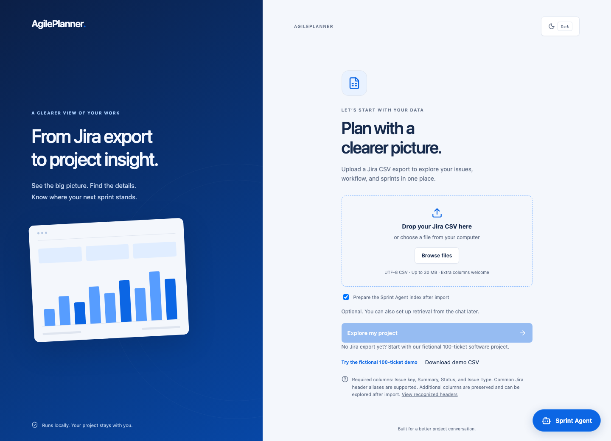

## Architecture


## What you can do

| 🤖 **[Sprint Agent](#sprint-agent)** | 🧪 **[Testing & evaluation](#evaluation)** | 🔎 **[Monitoring](#monitoring)** |
| :--- | :--- | :--- |
| • Ask about tickets, sprints & people<br>• Find related work with hybrid search<br>• Get streamed answers with sources | • Compare models on golden questions<br>• Version project prompts & test data<br>• Review evidence, scores & latency | • Follow conversations & tool calls<br>• Track tokens, context & estimated cost<br>• Inspect errors & user feedback |
| 📊 **[Overview](#overview)** | 🏃 **[Sprint Explorer](#sprint-explorer)** | 🧩 **[Backlog Management](#backlog-management)** |
| • Explore status, type & team metrics<br>• Search tickets by ID, title or topic<br>• Flag similar To Do tickets | • Switch sprints & filter ticket lists<br>• See assignees, reporters & work mix<br>• Open tickets and linked work | • Define unfinished work & capacity<br>• Find priority, estimate & owner gaps<br>• Get AI assessments, themes & suggested owners |

### AI beyond chat

- **Find similar tickets:** discover related work through keyword/semantic search and flag potential To Do duplicates.
- **Get a ticket assessment:** open **Generate AI Summary and Suggestions** to review requirements, acceptance criteria, comments and similar-ticket evidence.
- **Enhance ticket descriptions:** ask Sprint Agent to draft clearer requirements and acceptance criteria using the available ticket context.
- **Explore code and solution suggestions:** ask for implementation approaches, potential fixes and illustrative code snippets grounded in the exported work.
- **Manage the backlog with AI:** review ticket batches, uncover refinement gaps, group work into themes and assess suggested owners against team roles and planning budgets.

Description and code drafts are requested through Sprint Agent. AI suggestions stay reviewable; they do not edit Jira or your code.

For ticket improvements and solution suggestions, the agent searches similar tickets using the current ticket's summary and description, then reads relevant matches for requirements, acceptance criteria and comments. Related-ticket evidence informs suggestions; it does not prove a shared root cause or a verified fix. Narrative embeddings include `Comment`, `Comments`, `Custom field (Comment)` and `Custom field (Comments)` exports. Each chunk belongs to one ticket; short tickets remain one chunk, while larger tickets split with the same title and field headers repeated on every chunk.

[Get started](#try-it) · [Agent engineering](#engineering-for-relevance-latency-and-cost) · [LLMOps workflow](#llmops-improve-your-agent-with-evidence) · [Project guides](#project-guides)

## Sprint Agent

**Ask a project question. Let the agent investigate the evidence.**

Find and explain tickets, summarize sprints, explore related work or review the backlog. The agent resolves conversation context, chooses tools and writes an answer from the results. Ticket summaries and suggestions also appear inside ticket details.

> “What did this developer work on?” · “Who can take this up?” · “Which tickets still need estimates?”

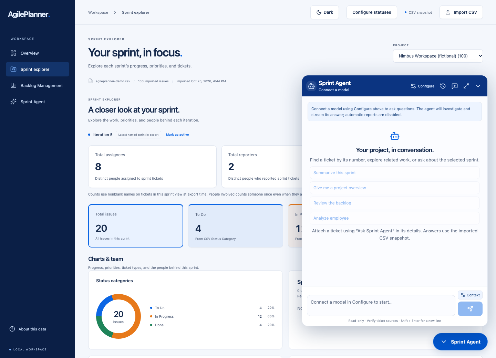

### Engineering for relevance, latency and cost

The goal is useful project decisions with answers you can inspect and improve. These choices make the agent's work easier to control:

| Design choice | Why it's there |
| --- | --- |
| **Intent-led tool use** | Query MongoDB for people, filters and totals; retrieve narrative evidence for meaning and related work |
| **Hybrid search + relationships** | Combine exact/keyword matches, vectors, reranking and exported ticket links |
| **Batched evidence review** | Inspect bounded chunk packets with the selected model; retain verified quotes and report review coverage |
| **Retrieval caching** | Reuse query vectors, results and conservative candidate pools with bounded TTL/LRU caches; generate answers afresh |
| **Context & memory budgets** | Refresh conversation scope, select relevant evidence and trim history/tool payloads to the configured window |
| **Effort limits** | Bound tool actions, model requests and investigation passes; reserve room for the final answer |
| **Input & evidence checks** | Screen inappropriate input, clarify ambiguous references and validate quoted evidence against source chunks |
| **Measured iteration** | Compare prompt/data revisions and models using answer quality, latency, calls, tokens and estimated cost |

Streaming exposes progress while work continues. Reuse of the persisted index avoids rebuilding it for every conversation. Batching and caching target repeated retrieval work; model-based evidence review can add calls, so effort settings control that tradeoff.

**Improve performance over time:** inspect slow or weak answers, change one setting or prompt revision, replay the same golden questions, then compare quality and resource use. [Engineering decisions & measurement workflow](docs/agent_engineering.md).

### Configure your agent

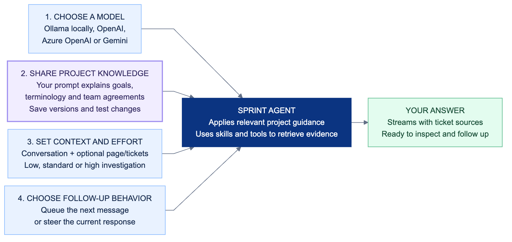

**Share the knowledge behind your tickets.** Your **project knowledge prompt** explains what you're building, your goals, team terminology and working agreements. Saved guidance gives the selected model project-specific context for relevant questions.

> “Our current goal is reliable sign-in. Flag work missing estimates and explain unfamiliar terms.”

Find it under **Configure → Project context & working agreements**. View and edit prompt versions in **Evaluation → Project prompts**, test a change, then choose **Use for chat**.

Move, resize or expand the chat. Resume conversations, retry failed messages and leave thumbs feedback or a short note. Your export, settings and retrieval index survive refreshes and restarts.

[Model setup](backend/app/agent/README.md) · [Conversation controls](docs/conversations.md) · [Retrieval design](docs/retrieval.md)

## Try it

Start Docker Desktop, clone the repo, then run:

```sh
git clone https://github.com/joshuadominic0598/agile-planner-agent-for-jira.git
cd agile-planner-agent-for-jira
make start
```

Open **[localhost:8000](http://localhost:8000)**. Analytics needs no AI key or Jira login.

1. **Load:** upload a Jira CSV or try the **100-ticket demo**.
2. **Configure:** keep your statuses or group, reorder and color them.
3. **Explore:** browse analytics, sprints and tickets. Add AI whenever you're ready.

[Download the demo](resources/demo/agileplanner-demo.csv) · [CSV requirements & setup](backend/README.md) · Excel users: export as **CSV UTF-8**.

### Private local AI setup

Install [Ollama](https://ollama.com/), then download a local chat model and either or both embedding models:

```sh
ollama pull qwen3:8b
ollama pull embeddinggemma
ollama pull qwen3-embedding:4b
```

The two embedding choices run locally without per-token API fees. [EmbeddingGemma](https://ollama.com/library/embeddinggemma) is a 300M-parameter model (about 622 MB download, Gemma terms); [Qwen3 Embedding 4B](https://huggingface.co/Qwen/Qwen3-Embedding-4B) is a larger Apache-2.0 model ([about 2.5 GB in Ollama](https://ollama.com/library/qwen3-embedding:4b)). Download size is not runtime memory usage. Quality and speed depend on your hardware and ticket vocabulary; compare retrieval on your own questions.

1. Run `make start` and select **Embedding model & chunk size** while importing your Jira CSV. Keyword-only search is available immediately without any model download.
2. Choose **Smaller** or **Larger** and prepare the index. The model and chunk policy are saved per import; the configuration steps below also cover existing imports.
3. Connect your local chat model using **Configure → Add connection**, with the OpenAI-compatible provider, model `qwen3:8b` and base URL `http://host.docker.internal:11434/v1` for Docker Desktop. For host development, use `http://127.0.0.1:11434/v1`. No API key is needed for local Ollama. See [model setup](docs/jira_agent.md).

Both private embedding choices use local Ollama endpoints only and never fall back to cloud embedding services. Model downloads contact the model registry; ticket indexing and search run locally. If Ollama or a selected model is missing, analytics remains available and indexing shows an actionable retry message. Inputs beyond model context are rejected instead of silently truncated.

`JIRA_LOCAL_EMBEDDING_BASE_URL` configures the local Ollama endpoint independently of legacy provider settings. Compose defaults to `http://host.docker.internal:11434/v1`; direct Python development defaults to `http://127.0.0.1:11434/v1`. Only loopback / Docker host URLs are accepted for the private choices. When running the API directly on the host with a copied `.env`, set this variable to the loopback URL.

### Embedding models and configuration

**The embedding model finds relevant ticket passages; the chat model writes the answer.** They are separate choices. You can change the chat model without rebuilding search vectors.

| Choice in the app | Embedding model | Maximum characters per chunk | Narrative overlap | Tradeoff |
| --- | --- | ---: | ---: | --- |
| **Keyword search only** | No model; local TF-IDF + keyword search | 1,000 | 200 | Default for new imports; no download, no semantic embeddings |
| **Smaller** | `embeddinggemma` · local Ollama | 1,000 | 200 | Lower model memory use, focused passages |
| **Larger** | `qwen3-embedding:4b` · local Ollama | 3,000 | 500 | More passage context, higher model memory use; may take longer |

Both embedding models run locally with **no API key or per-token fees**. These are maximum **character counts, not token counts**. A smaller chunk can create more vectors, so smaller does not automatically mean faster indexing or better retrieval. Model quality and speed should be checked against your own ticket questions.

**For a new import:** choose **Embedding model & chunk size** on the upload screen. Leave **Prepare the Sprint Agent index after import** checked to build immediately. If you uncheck it, the choice is still saved; prepare the index later from Sprint Agent.

**For an existing import:** open **Sprint Agent → Configure**, choose the embedding profile, then click **Rebuild ticket index** or **Prepare agent index**. Selecting an option alone does not rebuild or replace the saved configuration. A model change requires rebuilding all vectors for that import; other imports keep their own choices. Search is ready when the index reports **Ticket context is ready**, with its model, ticket/chunk counts, character cap and overlap. The saved index is reused across conversations, refreshes and restarts.

**What gets embedded:** each ticket's summary, description, acceptance criteria, exported comments and attachment references. `Comment`, `Comments`, `Custom field (Comment)` and `Custom field (Comments)` are supported. Attachment contents are never downloaded or embedded. People, status, sprint, estimates and other metadata remain queryable in MongoDB; IDs and project keys join results back to their original tickets.

**How chunks work:** a ticket that fits stays in one chunk, even if undersized. Larger tickets split without combining content from different tickets or truncating the narrative before splitting. Every chunk repeats the title and the Description, Acceptance criteria, Comments and Attachment references headers. A field without an excerpt in that chunk is marked explicitly. Repeated titles and headers count toward the cap; the 200/500-character overlap preserves narrative text across field boundaries. Long summaries are retained in a separate full-summary field as well as the repeated short title.

**From export to answer:** import complete ticket fields and metadata into MongoDB, build the per-ticket chunks, embed them with local Ollama, then store vectors and the keyword index in SQLite. Questions use the same embedding model as that import's index. Hybrid retrieval combines vector similarity with keyword matches; relevant ticket details and comments are supplied to the selected chat model for its answer. The original CSV is not reopened for each question.

Older imports may show **Current server configuration**, which reflects the legacy `JIRA_EMBEDDING_*` environment settings and can include a hosted provider. Choose **Smaller** or **Larger** and rebuild to move that import to the explicit private Ollama setup. The private profiles use `JIRA_LOCAL_EMBEDDING_BASE_URL` and never inherit a hosted embedding API key or silently switch to cloud embeddings. If a model is missing, run the `ollama pull` command shown by the chooser, keep Ollama running, and retry. Analytics remains available while the index is missing, building or failed.

## Explore the workspace

### Overview

Project totals, status charts and team insights. Search by ticket number, title or topic; filter results and flag **similar To Do tickets** for review.

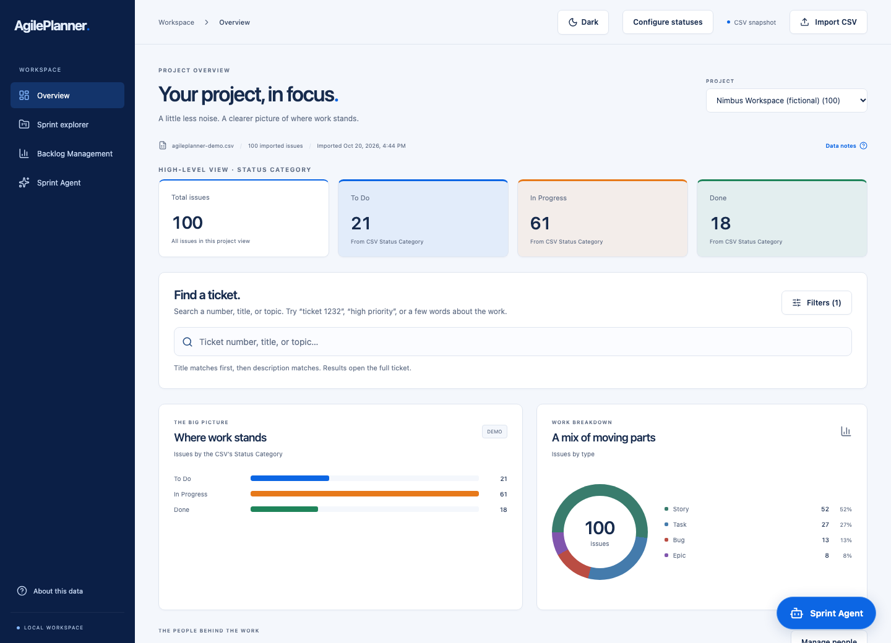

### Sprint explorer

Switch sprints, filter tickets from metric cards and see who's involved. Open tickets full screen to inspect details, hierarchy, linked work, comments and attachment references.

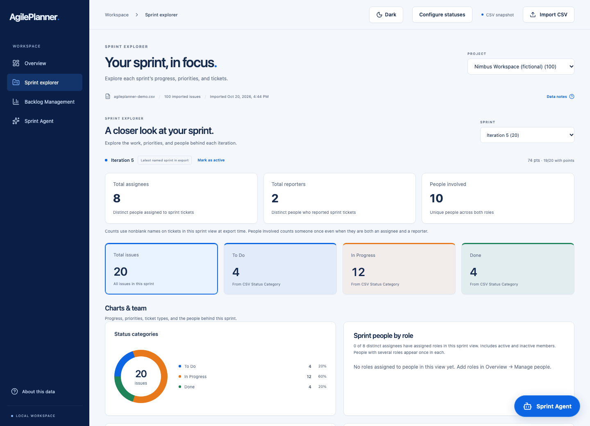

### Backlog Management

Set your unfinished-work rule and review **Ready for planning**, **Needs triage** and **Assignee refinement**. Filter by priority and browse 20 tickets at a time.

**People & planning** shows roles, typical work, average assigned points per sprint and recent tickets. Ask AI to review a batch and suggest next steps or assignments.

AI reviews include ticket-specific findings, work themes and suggested owners where estimates, priorities and capacity allow. Continue through more batches while retaining earlier assessments.

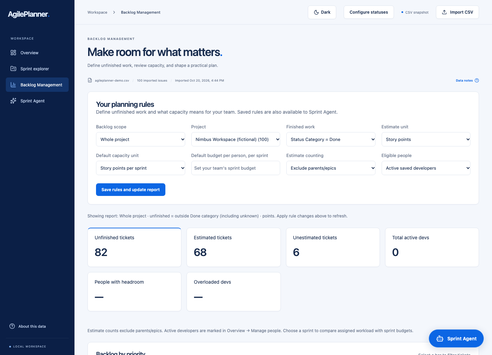

**Make it yours:** custom status names, order and colors; people roles; story-point or hourly budgets; light/dark themes.

## LLMOps: improve your agent with evidence

**Version the guidance. Test the change. Learn from real use.**

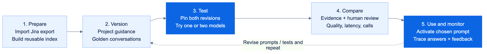

| Step | What you can do |
| --- | --- |
| **Version** | Save project prompts and golden conversations as separate revisions |
| **Test** | Pin a prompt + test-data revision; evaluate one model or compare two |
| **Review** | Compare answers, evidence, timing, calls and human scores |
| **Improve** | Use feedback to revise, retest and activate your chosen prompt |

**Evaluation → Project prompts** lets you view, edit and revisit guidance. **Use for chat** activates a saved revision; experiments can stay separate from live chat.

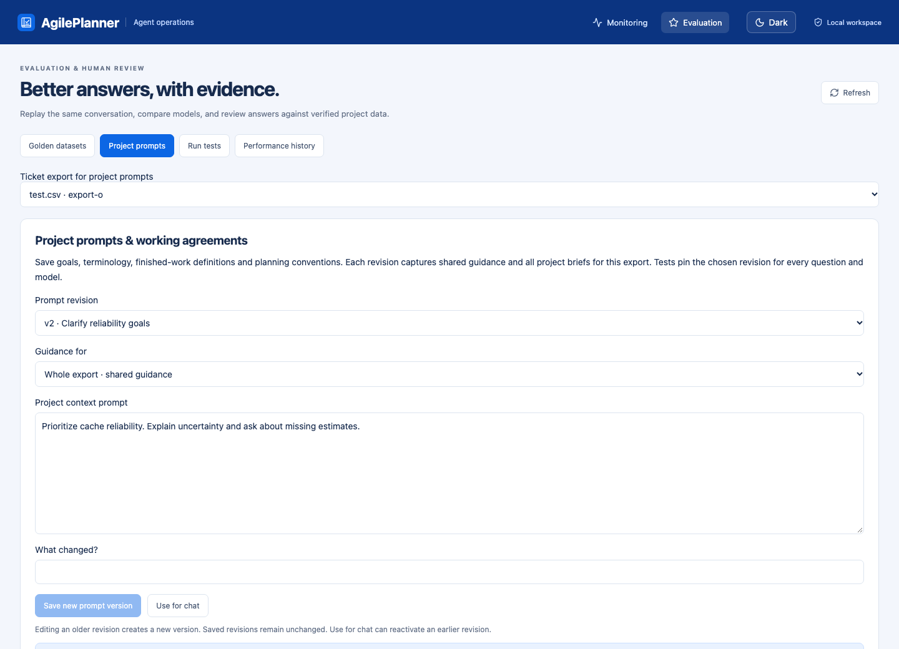

*Fictional guidance shown. Each test keeps its prompt snapshot and version identifiers.*

For a prompt comparison, hold the model and test data constant. For a model comparison, hold the prompt and test data constant. [LLMOps workflow & versioning](docs/llmops.md).

## Monitoring

After the one-time `make setup`:

```sh
make monitor
```

Open **[localhost:8012/monitoring](http://localhost:8012/monitoring)**. View all conversations or drill into one response. Metrics refresh every five seconds.

| Performance | Usage | Traceability |
| --- | --- | --- |
| Latency, first token, throughput | Tokens, requests, estimated costs | Prompt revision, model/tool calls |
| Failures & blocked inputs | Context sizes & retrieved chunks | Evidence, errors & user feedback |

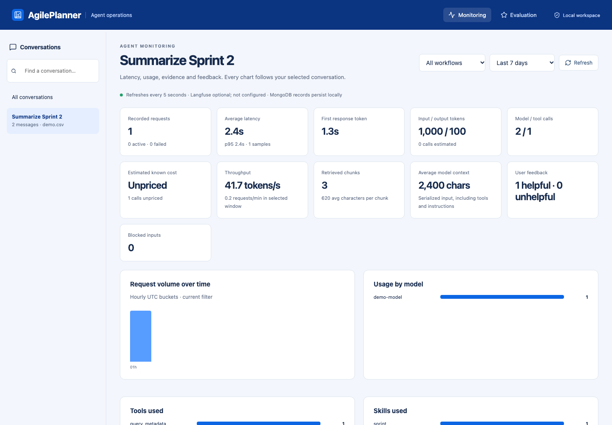

*Fictional demo traces.*

**Optional Langfuse:** add project credentials in `.env` to export observations and feedback. MongoDB keeps the local record. Unknown model prices remain **unpriced**.

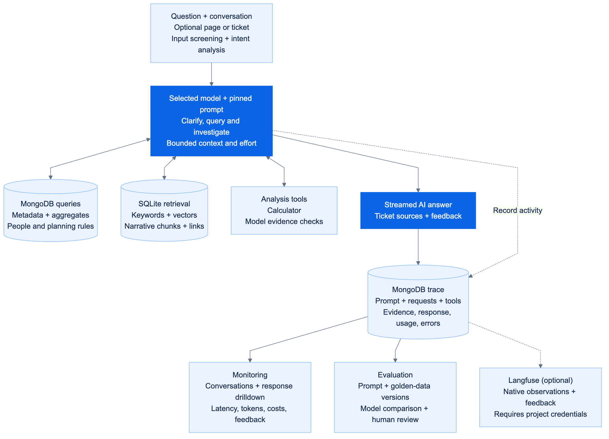

[Monitoring & Langfuse setup](docs/observability.md)

## Evaluation

```sh
make evaluation-setup       # once
make evaluation-dashboard
```

Open **[localhost:8013/evaluation](http://localhost:8013/evaluation)**.

| Screen | What you'll find |
| --- | --- |
| **Golden datasets** | Editable questions, expected answers and evidence; DOCX/JSON/CSV import |
| **Project prompts** | Shared/project guidance, revision history and chat activation |
| **Run tests** | One model or two, pinned versions and optional Ragas scoring |
| **Performance history** | Version filters, answer comparisons and human ratings |

Compare **latency, model/tool calls, Ragas, BLEU/ROUGE 2–5 and ROUGE-L** for each question. Rate answers **1–5** and add feedback. A CSV template and **10-exchange demo benchmark** are included.

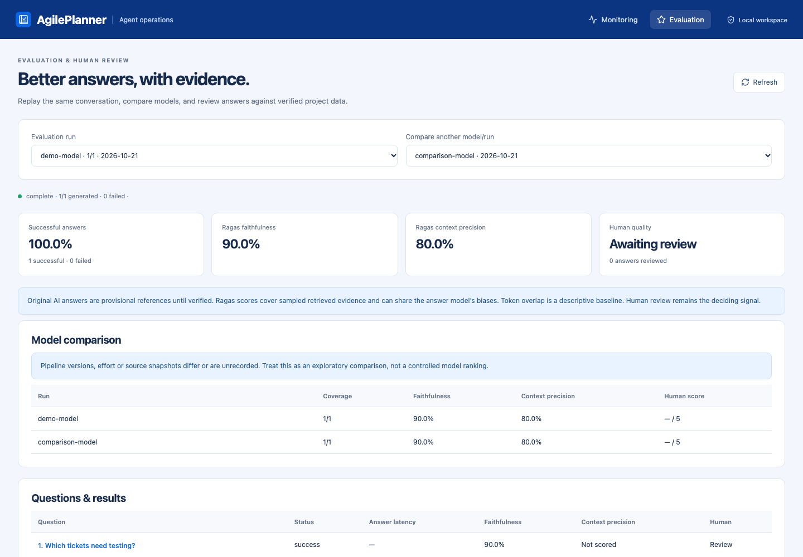

*Fictional examples and illustrative scores; not live benchmark results.*

Saved revisions stay unchanged. Expected evidence and actual retrieval remain separate; missing data is labeled. Wording scores support comparison; evidence and human review judge quality.

[Evaluation guide & metric definitions](docs/evaluation.md)

## Your workspace stays with you

```sh
make stop        # keep data
make start       # reopen workspace
make restart     # restart with saved data
make fresh-start # reset after confirmation and a private backup
```

Private exports, prompts and conversations stay outside Git. Attachment contents aren't read; connected AI providers receive the context used for requests. Planning uses a CSV snapshot, so it cannot establish historical velocity or actual availability. AI suggestions never change Jira.

## Project guides

Application code lives in `backend/` and `frontend/`; technical guides and editable diagrams live in `docs/`. Published README and reference images live in [resources/images](resources/images/README.md), with reusable icons in `resources/images/icons/`. Documentation and asset names use lowercase snake_case; conventional `README.md` entry points stay unchanged. See the [project layout](docs/README.md#project-structure) and [resources guide](resources/README.md) for public assets and private runtime folders.

**Sharing the project:** commit source, setup files, lockfiles, documentation and the fictional demo. Personal exports, credentials, databases, vectors, conversations, installed models and generated files stay local through `.gitignore`; private files are also excluded from Docker builds. New users run `make start` to create their own workspace. See [what to commit and how to review it](docs/repository_setup.md).

[Backend & API](backend/README.md) · [Frontend](frontend/README.md) · [Agent engineering](docs/agent_engineering.md) · [Model setup](backend/app/agent/README.md) · [LLMOps](docs/llmops.md) · [Monitoring](docs/observability.md) · [Evaluation](docs/evaluation.md) · [Commands](scripts/README.md) · [Data & privacy](resources/README.md)
