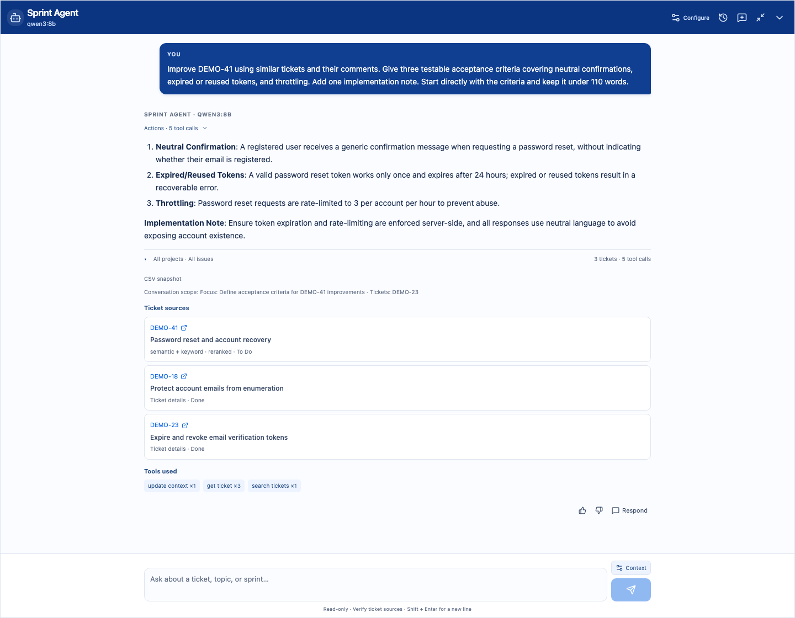

# Sprint Agent internals

[Product tour](../../../README.md) · [Backend API](../../README.md) · [Provider setup](../../../docs/jira_agent.md) · [Retrieval contract](../../../docs/retrieval.md)

Open the chat at the bottom right, ask about a ticket key/number or topic, or attach a ticket using **Ask Sprint Agent**. Page context is a hint: questions can expand to other sprints and projects in the same export. Ticket sources open the original issue drawer.

### Retrieval and grounding

| Data or operation | How it is handled |
| --- | --- |
| **Narrative evidence** | Titles, descriptions, acceptance criteria, exported comments and attachment references in vector/keyword indexes; never attachment bytes |
| **Ticket metadata** | Structured MongoDB queries for keys, people, sprint, status, priority, estimates and exported fields |
| **Hybrid search** | Vector similarity and BM25 keyword retrieval combined with reciprocal rank fusion, relevance/diversity reranking and issue deduplication |
| **Graph expansion** | Validated parent/child and exported links, plus shared labels/components/versions; unrelated graph neighbors do not establish ownership |
| **Analytical reports** | Sprint, project, backlog and employee workflows use verified counts and calculator-backed findings |
| **Reference clarification** | Ask before guessing a singular ticket; preserve plural ticket sets and ownership questions with batch MongoDB lookup |
| **Conversation memory** | Persistent person/filter scope, model-aware history/evidence budgets, saved conversations and independent new chats |
| **Caching** | Bounded scoped retrieval, query-vector and semantic candidate caches; answer text is generated per request |

Normal chat always uses a connected model. Local lexical TF-IDF vectors, FTS5 keyword search, structured queries and the relationship graph need no external embedding API, but those tools do not generate answers automatically. Semantic embeddings require a separately configured embedding provider and an index rebuild. Indexing can run after upload or later; unavailable/building/failed indexes show an explanatory state and recovery action.

### Model connections

| Connection | Setup |
| --- | --- |
| **Ollama / compatible server** | Run a tool-capable local model, then add its `/v1` endpoint and model name; optional Qwen3 8B/14B configurations are included |
| **OpenAI Platform** | Add your project API key and model ID, with optional project/organization headers |
| **Azure OpenAI** | Add the resource endpoint, deployment name and API key |
| **Google Gemini / AI Studio** | Add an AI Studio key and model; the app includes a free-tier setup template, with availability/quotas governed by Google |

Use **Configure → Add model connection** in the blue header, save and test it, then select the connection for your next question. No model, API key or local model installation is bundled automatically. Saved keys are encrypted on the backend. Environment defaults are available through [.env.example](../../../.env.example); see [agent setup](../../../docs/jira_agent.md) for exact provider and local model instructions.

### Chat experience

The chat supports dragging, resizing, full screen, dark-blue user messages, Markdown answers, expandable details and a dismissible activity panel. Streaming preserves manual scroll position; returning from configuration shows the latest messages. Small questions get compact answers; charts are limited to two. General tool use is capped at twenty calls and bounded by time/context budgets. Activity reports observable work; hidden model reasoning is not shown.

Follow-ups retain resolved people and filters, with a Remembering summary and Context controls beside the message box. Start fresh ignores earlier context for the next question without deleting messages. Larger configured models can receive expanded history and evidence budgets within their declared serving window. **New chat** starts independently; conversation history resumes a saved chat against its original snapshot.

[Retrieval design](../../../docs/retrieval.md) · [Model setup and agent limits](../../../docs/jira_agent.md) · [Memory and context budgets](../../../docs/conversations.md) · [Chat behavior and architecture](../../../docs/chat_experience.md)

## Code map

| Module | Responsibility |
| --- | --- |
| `routes.py` | Index lifecycle, persisted sessions and streamed chat HTTP boundary |
| `index.py`, `tools.py` | Title/description search indexes, graph access and structured read-only tools |
| `provider.py`, `transport.py`, `connections.py` | Provider tool loops, streaming transport and encrypted model connections |
| `conversation.py`, `context_budget.py` | Resolved conversational scope and bounded model context |
| `grounding.py` | Ticket prefetch and bounded retry when a model skips evidence |
| `project_context.py`, `prompt_versions.py`, `capacity.py` | Versioned owner briefs, pinned evaluation guidance and capacity evidence under an explicit planning assumption |
| `topics.py`, `rerank.py`, `terminology.py` | Theme grouping, relevance/diversity policy and evidence checks |
| `ports.py`, `retrieval_cache.py` | Cache contract and injected bounded TTL/LRU implementation |
| `skills/`, `skill_documents.py` | Four report contracts loaded at startup |

See [conversation memory](../../../docs/conversations.md) and [implementation boundaries](../../../docs/chat_experience.md) for durable scope, cache isolation and policy dependencies. These boundaries do not imply the entire legacy agent is a hexagonal architecture.

Changes to retrieval need backend tests that exercise actual isolated indexes and metadata scopes. Provider protocol tests use mocked responses; live answer quality must be checked separately with a configured model.

## Intent-first management flow

See [management-agent design](../../../docs/agile_agent.md) for model-owned planning, retrieval and synthesis, saved goals/conventions, point-capacity assumptions and grouped tool counts. Fixed findings curation has been removed.

## Complete ticket context

`ticket_context.py` adds bounded relationship, acceptance-criteria, comment and attachment-reference evidence to `get_ticket`. Grounding forwards it even when a large original field exhausts the general field budget. Incoming issue links are queried from MongoDB; related keys are cited as metadata until their full details are fetched. Attachment contents remain unavailable. See the [ticket finder and evidence guide](../../../docs/ticket_search.md).

### API compatibility

OpenAI and Azure use Responses by default. Exact GPT-3.5 Turbo model IDs automatically use Chat Completions, without unsupported reasoning or strict-schema controls, and with the configured context budget. Enter `gpt-3.5-turbo`, not a display label with spaces. For an Azure deployment with a custom name, select **Chat Completions** under **API compatibility** when that deployment needs the older API. Built-in public web search is available only with Responses.

See [GPT-3.5 Turbo](https://developers.openai.com/api/docs/models/gpt-3.5-turbo). Connection tests send a small calculator probe, never exported Jira tickets.
