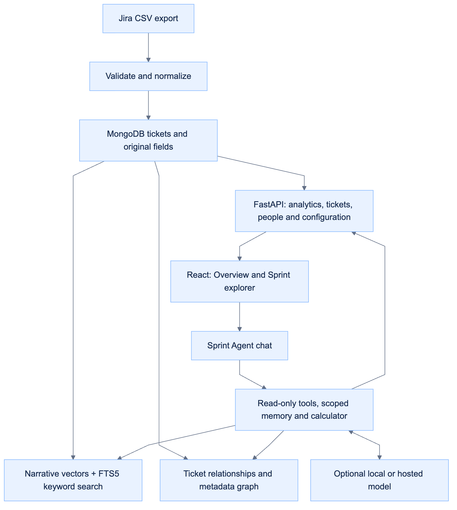

# Technical guides

[Back to the product tour](../README.md) · [Backend and API](../backend/README.md) · [Frontend](../frontend/README.md) · [Agent](../backend/app/agent/README.md) · [Scripts](../scripts/README.md) · [Local model configuration](../config/ollama/README.md)

Start here when you want to understand or change how AgilePlanner works. For trying the app, the root README is the shorter route.

[LLMOps workflow and prompt history](llmops.md) connects versioned project guidance, golden datasets, model comparisons and monitored feedback. Diagram sources are under `docs/diagrams/`.

## Architecture

Two parts share the same imported snapshot: an analytics dashboard and a read-only Sprint Agent. CSV is read at import only. MongoDB stores validated issues, original exported fields, configuration and conversations; SQLite holds the rebuildable narrative search and graph index. See [storage and migration](storage.md).



[Editable diagram source](diagrams/application_architecture.mmd)
| Piece | Job |
| --- | --- |
| **CSV import** | Validate core fields, preserve repeated/custom columns, resolve references and retain a separate snapshot per upload |
| **Analytics API** | Compute project/sprint counts, status distributions, people metrics, estimates and field summaries from stored records |
| **React workspace** | Upload/setup, interactive charts, ticket filters, issue details, people profiles and movable streaming chat |
| **Retrieval and agent** | Combine exact metadata queries, title/description search and graph traversal; return ticket sources and verified calculations |
| **Model connections** | Optional Ollama, OpenAI Platform, Azure OpenAI, Gemini or OpenAI-compatible server; keys stay on the backend |

### Container runtime

The app container serves React and FastAPI at [localhost:8000](http://localhost:8000), alongside a MongoDB container. Bind mounts keep MongoDB files in `resources/mongodb/` and retrieval data/credentials in `resources/app/`. No external vector service is required.

| File | Responsibility |
| --- | --- |
| [Dockerfile](../Dockerfile) | Build the React frontend and package the non-root Python API runtime |
| [compose.yaml](../compose.yaml) | Bind the app to localhost, pass provider settings and mount persistent storage |
| [scripts/start.sh](../scripts/start.sh) | Check Docker, rebuild changed sources or reuse the matching image, start services, wait for health and open the browser |
| [.env.example](../.env.example) | Document optional model, embedding, context-window and web-search settings |

## Runtime commands

Run these from the repository root.

| Command | What it does |
| --- | --- |
| `make start` | Reuse the matching image or rebuild changed sources; start services and wait until healthy |
| `make restart` | Recreate the container using the existing image and current environment settings; does not rebuild source changes |
| `make stop` | Stop/remove containers while preserving the imported project data folders |
| `make logs` | Follow service logs |
| `make build` | Explicitly rebuild the image without starting services |
| `PORT=8080 make start` | Use another host port |
| `OPEN_BROWSER=0 make start` | Start without opening the browser |

## Local development

Requires **Python 3.12+**, **Node.js 24+** and **pnpm 11.25.0**. Install pnpm with `npm install --global pnpm@11.25.0` if needed.

```sh
make setup
make database  # MongoDB on localhost:27018
make backend   # Terminal 1: API on http://127.0.0.1:8000
make frontend  # Terminal 2: Vite on http://127.0.0.1:5173
```

Open [the development frontend](http://127.0.0.1:5173). Vite proxies `/api` to FastAPI. The [interactive API documentation](http://localhost:8000/docs) is served by the backend. Override the Python executable with `make setup PYTHON=/path/to/python3.12`; `PNPM` can also be overridden. Local MongoDB defaults to `mongodb://127.0.0.1:27018`, database `sprintlens`. `JIRA_DATA_DIR` defaults to project-relative `resources/app`, regardless of the working directory.

## CSV compatibility

| Input | Contract |
| --- | --- |
| **Required columns** | Issue key, Summary, Status and Issue Type |
| **Recognized aliases** | Common alternatives such as Work item key, Title, Work Type and Workflow status; inspect `/api/csv-schema` for the full list |
| **Optional data** | Project, Sprint, Status Category, Priority, Assignee, Reporter, estimates, relationships and other exported fields enrich available views |
| **Extra/repeated columns** | Accepted and preserved; repeated headers retain all their values, and eligible fields support value-count charts |
| **Limits** | 30 MB, 50,000 issues and 1,000 named columns |
| **Invalid input** | Missing required fields, malformed rows and duplicate keys produce explanatory errors instead of silently dropping records |

Core header meanings must be recognized; rename unsupported localized headers to a supported alias. Unknown field semantics and units are not inferred. See the [data contract](data_and_roadmap.md) for compatibility and snapshot limits.

## Dashboard counting and configuration

- **Category colors:** To Do is blue, In Progress orange, and Done green in the project/sprint category cards and charts. Colors follow category names rather than their order. Custom categories use the chart palette; saved detailed-status colors stay intact.
- **High-level cards use the CSV’s Status Category column**, alongside Total issues. These category names and counts come directly from the export and remain unchanged by status renaming.
- **Every discovered status gets a detailed KPI card**, at project and sprint level. No status names or completion/testing buckets are predefined. Production, Done, and unfamiliar statuses remain separate by default.
- **Status order and colors:** move statuses up/down and choose a card color in setup or through **Configure statuses** at the top of the dashboard. The same saved appearance is used in every sprint, including zero-count cards. Combined statuses use their first position and one shared color.
- **People & work:** see distinct assignee counts and the ticket-type mix each person handles in the project snapshot, across the selected project view. **Manage people** lets you add custom work-area labels such as Data, AI, DevOps, Backend, Frontend, or Lead and explicitly mark developers. **Active Developers** counts people marked as developers; **Other Members**, immediately to its right, counts active people not marked as developers, including unlabeled people. **Inactive Members** counts people marked inactive in Manage people; these three counts add up to People assigned; roles are never inferred from ticket types.
- **Role charts:** horizontal bars show distinct people in each role in Overview and Sprint explorer. Overview covers the project; Sprint explorer uses only people assigned tickets in the selected sprint. Multi-role people appear once per role, and historical counts include inactive members. Click an Overview role bar to open matching people.
- **Save people profiles:** a successful save closes customization and updates the metrics/charts without replacing the section with a loading screen. A failed save keeps the panel and edits open with an error; a count-refresh failure is labeled separately.
- **Interactive overview:** click a status-category or detailed-status card to open its matching tickets in Sprint explorer with All issues selected.
- **Inactive people:** use the Membership selector in **Manage people** to mark former team members inactive or reactivate them. Filter the list by All, Active, or Inactive. Their roles, ticket counts, and historical sprint participation remain intact; they are excluded from active team counts. Existing profiles default to active, and CSV dates never automatically determine membership.
- **One status setup** appears after every CSV import and is available later through **Configure statuses**. The left column shows the original status and count; the right column is a free-text display name.
- **Rename or combine only by choice.** Type a new stage name to rename a status. Give multiple statuses the exact same display name to aggregate their counts. Stage names are case-sensitive. **Restore original names** resets the selected project's draft.
- **Multiple projects:** switch projects within setup without losing edits. Saving validates all edited projects before writing them together. Choosing **Use original statuses** explicitly saves the original names for every project in that import.
- **Sprint people:** Total assignees and Total reporters count distinct nonblank names on tickets in the selected project/sprint. People involved counts the union, so a person appearing in both roles is counted once. These describe assignments/reporters at export time.
- **Sprint cards are filters.** Click a status/stage to show exactly those issues below. Existing ticket filters are cleared; further searches can narrow the selection. Total / Clear selection restores the sprint list. Zero-count cards keep all project statuses visible when switching sprints.
- **Relationships and issue types have independent cues.** Purple parent badges and row accents identify tickets with direct exported children. Bug/Defect badges use coral, Epic purple, Story teal, Task blue; other type names receive stable colors. A parent can also be a bug. Ticket references are resolved from keys, numeric IDs, and project ticket numbers; titles appear in relationship fields, field charts, and parent/child navigation across sprints. Ambiguous or missing targets are labeled, and relationship filters find parents, children, or standalone work. Counts stay at issue level; child estimates are not rolled into parents.
- **Extra fields can be explored.** In **Overview**, choose an exported field to see project-wide value counts. Clicking a value or blank opens matching tickets in **Sprint explorer**, with **All issues** selected so the list matches the chart count. Repeated values count each issue once per distinct value; these totals may overlap. Fields with over 50 distinct values, long text, or no populated values stay in full issue details.
- **Resolution stays separate from progress.** Its filter discovers source values and includes blanks without deriving them from Done.
- **Estimate units stay separate.** Sprint cards show story points, original estimate, remaining estimate, and time spent with coverage. Recognized Jira numeric time fields are converted from seconds to hours; unknown custom units remain raw fields. Conflicting or invalid estimates are excluded with import warnings.
- **Original Jira values stay intact** in the issue list and details. Only display grouping changes. Settings persist per project and imported snapshot.
- **Latest named sprint** is a suggestion based on natural name order. Use **Mark as active** to save your choice in this browser.

Status/stage counts sum to Total without double counting. In the all-project view, identical displayed names aggregate across projects; each project's mapping still applies independently. See [Data foundation and roadmap](data_and_roadmap.md) for the full contract.

[Jira configuration research](jira_configuration_research.md) explains what projects can customize beyond statuses and the implications for CSV compatibility.

[View the single status setup](../resources/images/setup.png) or [the parent/child issue drawer](../resources/images/hierarchy.png) and [People & work](../resources/images/people.png), using synthetic example data.

## Project structure

| Area | Responsibility |
| --- | --- |
| [backend/app](../backend/app) | CSV import, MongoDB persistence, analytics, field discovery, workflow configuration, people and HTTP endpoints |
| [backend/app/agent](../backend/app/agent) | Retrieval indexes, read-only tools, model adapters, scoped conversations, response grounding and caches |
| [backend/app/agent/skills](../backend/app/agent/skills) | Sprint, project, backlog and employee analytical response contracts |
| [frontend/src](../frontend/src) | React dashboard, upload/setup, ticket details, people management and chat |
| [backend/tests](../backend/tests) / [frontend/tests](../frontend/tests) | Backend and desktop/mobile browser verification |
| [config/ollama](../config/ollama) | Optional Qwen3 8B/14B serving configurations |
| [scripts](../scripts) | Container startup, CSV verification and agent verification helpers |
| [docs](.) | Data/model/retrieval contracts, design notes, editable diagrams and recorded verification |
| [resources/images](../resources/images/README.md) | Published screenshots, rendered diagrams and attributed technology icons |
| [resources/demo](../resources/demo) | Public fictional exports and evaluation examples |

Documentation folders, guides, diagrams and image assets use lowercase snake_case names; `README.md` remains the conventional entry point. Source code follows its language and framework conventions, including PascalCase React components. Private runtime data and temporary captures stay in ignored resource folders; see [project resources](../resources/README.md).

<details>
<summary>Folder layout</summary>

```text
agile-planner-agent-for-jira/
├── backend/
│   ├── app/
│   │   ├── main.py              FastAPI routes and production static hosting
│   │   ├── importer.py          Validation and normalization of CSV snapshots
│   │   ├── store.py             MongoDB persistence and restart recovery
│   │   ├── analytics.py         Project and sprint metrics
│   │   ├── workflow.py          Discovered statuses and display configuration
│   │   ├── people.py            Roles, membership and assignment summaries
│   │   ├── references.py        Ticket reference resolution
│   │   └── agent/              Retrieval, model connections, tools and memory
│   └── tests/
├── frontend/
│   ├── src/
│   │   ├── App.tsx             Upload, setup, analytics and ticket navigation
│   │   ├── AgentChat.tsx       Streaming chat and conversation controls
│   │   └── styles.css          Dashboard theme and responsive layout
│   └── tests/
├── config/ollama/               Optional local model configurations
├── docs/                       Contracts, editable diagrams and verification notes
├── resources/
│   ├── images/                 Published screenshots, diagrams and icons
│   ├── demo/                   Public fictional examples
│   └── app/                    Ignored private uploads and retrieval data
├── scripts/                    Startup and verification helpers
├── .env.example                Optional AI/embedding configuration template
├── compose.yaml                Local service and persistent volume
├── Dockerfile                  Frontend build and backend runtime
└── Makefile                    Startup, development and checks
```

</details>

<details>
<summary>Component responsibilities for contributors</summary>

| Component | Responsibility |
| --- | --- |
| `backend/app/importer.py` | CSV validation, duplicate column preservation, normalization, import jobs |
| `backend/app/analytics.py` | Project/sprint totals and dynamically discovered status cards |
| `backend/app/workflow.py` | Exact status discovery, free-text renaming/merging, shared issue classifier |
| `backend/app/csv_schema.json` | Reference sample columns and repeated occurrences; not an allowlist |
| `backend/app/columns.py` | Core aliases, optional numeric fields, explicit units |
| `backend/app/fields.py` | Arbitrary field catalog, bounded value-count charts, exact filters |
| `backend/app/references.py` | Resolve ticket keys, IDs and project numbers to titles; preserve original CSV values |
| `backend/app/people.py` | Observed assignee/type distributions and validated developer/work-area profiles |
| `frontend/src/People.tsx` | People metrics, role drilldowns, profile editing, and save feedback |
| `frontend/src/RoleChart.tsx` | Shared horizontal role chart and optional people drilldown |
| `frontend/src/SprintRoles.tsx` | Project/sprint scoped role counts and chart loading/errors |
| `backend/app/hierarchy.py` | Parent key/ID and Epic Link resolution, child counts, cycle handling |
| `frontend/src/IssueIdentity.tsx` | Independent type colors and purple parent badges |
| `frontend/src/FieldExplorer.tsx` | Optional exported-field charts and click-to-filter |
| `frontend/src/WorkflowEditor.tsx` | Single status-to-display-name setup at import and on the dashboard |
| `backend/app/agent/` | Persistent vector/keyword/graph retrieval, read-only tools, model adapters and scoped chat API |
| `frontend/src/AgentChat.tsx` | Streaming chat, model selector, attachments, activity, charts, cross-page sessions and retry feedback |
| `frontend/src/AgentAnswer.tsx` | Safe Markdown/GFM rendering, verified ticket links and data-backed charts |
| `backend/app/agent/skills/` | Evidence and response contracts for sprint/project/backlog/employee analysis |
| `backend/app/agent/project_context.py` / `capacity.py` | Saved owner briefs and conditional capacity evidence |
| `backend/app/agent/conversation.py` | Persistent resolved people, ticket and metadata scope; prompt augmentation and contextual retrieval |
| `backend/app/agent/context_budget.py` | Model-aware history/evidence budgets and complete tool-round pruning |
| `frontend/src/AgentHistory.tsx` | Paginated saved chats and original-snapshot restoration |
| `backend/app/agent/topics.py` / `rerank.py` | Plain-data theme grouping and relevance/diversity policy |
| `backend/app/agent/ports.py` / `retrieval_cache.py` | Retrieval cache contract and injected, bounded TTL/LRU implementation |
| `frontend/src/useAgentWindow.ts` / `AgentProgress.tsx` | Window geometry/full screen and dismissible, honest progress |
| `backend/app/agent/grounding.py` | Ticket prefetch, single-ticket follow-ups, missed-tool retry and labeled retrieval fallback |
| `frontend/src/AgentConnections.tsx` | Saved local/GPT/Azure connection forms, key editing and connection tests |
| `backend/app/agent/connections.py` | Encrypted server credentials, allowed model choices and redacted profile API |
| `backend/app/store.py` | MongoDB persistence and restart recovery |
| `backend/app/main.py` | FastAPI endpoints and production static hosting |
| `frontend/src/App.tsx` | Upload, processing, dashboard, filters, and issue details |
| `frontend/src/styles.css` | Blue theme tokens, interactive states, and responsive desktop/mobile layout |
| `Dockerfile` | React build stage and non-root FastAPI runtime |

</details>

## Verification

```sh
make test
cd frontend
pnpm exec playwright install chromium  # First time only
pnpm test:e2e
cd ..
make check  # Lint and formatting checks for agent code
make format # Apply the checked-in agent formatting rules
```

Backend tests cover validation, repeated fields, sprint deduplication, unmodified status defaults, free-text grouping, validated multi-project saves, arbitrary extra columns, header aliases, distinct point/time units, resolution filtering, hierarchy navigation, cycles, restart backfill, project separation, filters, pagination, missing estimates, limits, and persistence. Browser tests run against the built React app and real API at desktop and mobile sizes, covering import/retry, filters, pagination, safe detail rendering, sprint selection, active markers, initial status setup, free-text editing, dynamic KPI filters, field charts, resolution/relationship filters, type/parent colors, related-ticket navigation, and refresh persistence. Browser test data is synthetic and stored separately under `resources/tests/e2e` and MongoDB database `sprintlens_e2e`.

To check your own CSV against the running app (prints aggregate counts only):

```sh
PYTHONPATH=backend .venv/bin/python scripts/verify_csv.py /path/to/export.csv
# Recheck the returned dataset ID after a restart:
PYTHONPATH=backend .venv/bin/python scripts/verify_csv.py /path/to/export.csv --check-id DATASET_ID
```

Recorded validation (October 18, 2026) with the reference export: **2,139 issues, six projects, 12 discovered statuses**, and all **232 exported column occurrences** retained. That export produces separate Done (1,715), Production (32), Testing (14), and Test Complete (6) cards; no automatic merging occurs. High-level Status Category totals are Done (1,749), In Progress (103), and To Do (287), read directly from the CSV. The supplied export also exposes 76 tickets with direct children and 1,018 tickets with parent references. The production build, 116 backend tests, and 40 desktop/mobile browser tests cover import/setup, grouping, fields, units, reference titles, status order/colors, people labels/counts, relationships, filters, and persistence.

Recorded chat verification: [chat experience](verification/chat_experience.json) and [conversation memory](verification/conversation_memory.json). These are saved results, not a live CI status.

## Detailed guides

| Guide | What it covers |
| --- | --- |
| [Data foundation and roadmap](data_and_roadmap.md) | CSV contract, analytics semantics, preserved data and future work |
| [Jira configuration research](jira_configuration_research.md) | Workflow, board, issue-type, custom-field and estimate differences between Jira projects |
| [Sprint Agent](jira_agent.md) | Model connections, indexing, tools, privacy and execution limits |
| [Retrieval](retrieval.md) | Indexed fields, hybrid ranking, graph traversal and analytical workflows |
| [Conversations](conversations.md) | Persistent scope, history and model-aware context budgets |
| [Chat experience](chat_experience.md) | Window behavior, response quality, caches, architecture and verification |

## Data handling and operating scope

This is a **local, single-user application**. It has no authentication or tenant isolation and should stay bound to localhost. Uploads and the default retrieval index stay on the local server. Optional configured model and embedding providers receive context as described in [Sprint Agent](jira_agent.md); no Jira API is called. Each upload creates a separate snapshot. MongoDB retains normalized records and complete exported values, while the original CSV bytes are discarded after import. The source filename, upload timestamp, and SHA-256 fingerprint identify each import. Stopping/rebuilding preserves the bind-mounted files under resources/. Browser storage holds the selected dataset ID, user-marked active sprint and dataset conversation IDs. MongoDB persists conversations, project status appearance and people profiles per snapshot; SQLite retains only the retrieval index. People are identified by their exact exported assignee name; two different people with the same name cannot be distinguished without additional identity data. Counts describe observed assignments and do not establish team capacity or historical contributions.

The supplied project export, generated data, and local environments are ignored by Git and excluded from the Docker build context. Avoid committing private Jira exports. The first read-only agent is implemented; live Jira synchronization and write actions remain future work.

[Model-led project-management assistant](agile_agent.md) documents the current AI flow; earlier verification records mentioning fixed reports describe the superseded behavior.
