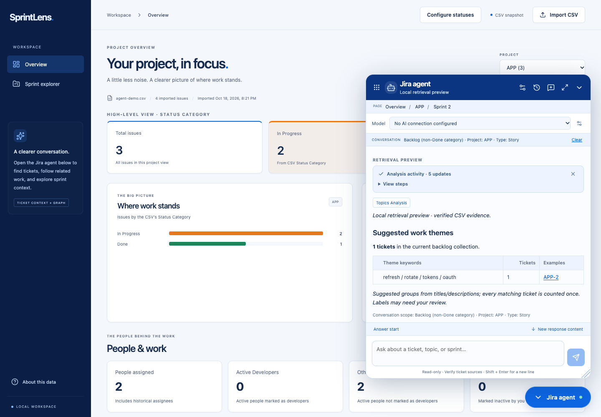
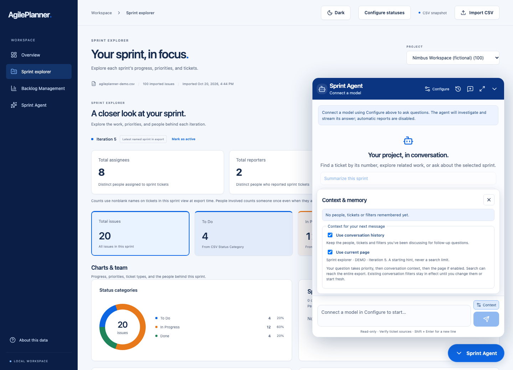
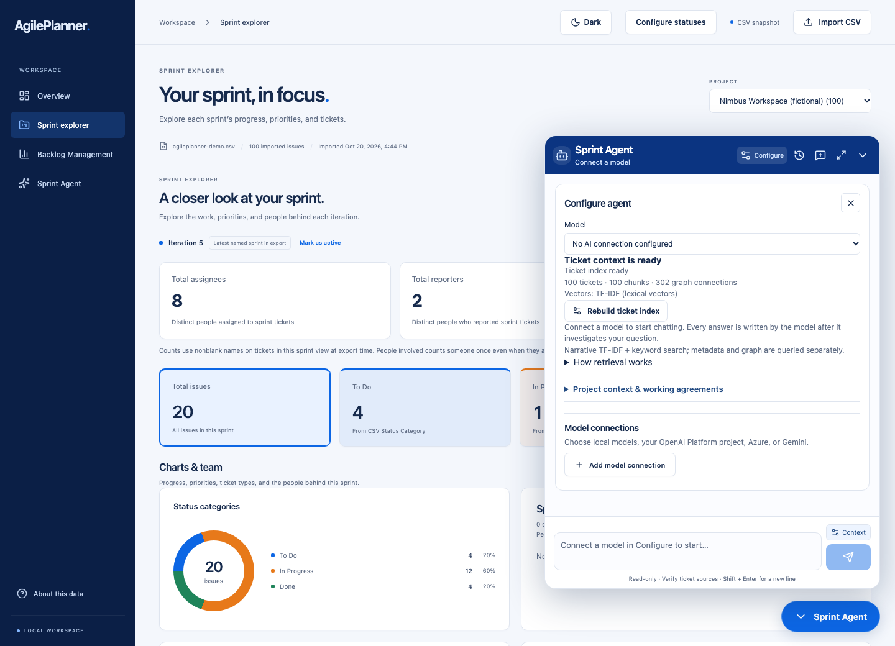

# Chat experience and implementation boundaries

Model selection and agent configuration live under **Configure** in the blue header. The transcript starts directly below it. Optional conversation/page context and the plain-language **Start fresh** action sit beside the message box; see [message context controls](conversations.md#message-context-controls).

The chat is a reading surface: sending a question positions the new answer at its beginning. Subsequent stream chunks, activities and completion do not change scroll position. There are no answer-navigation bars. Reopening chat or returning from Configure/history scrolls to the latest message; reading and streaming never force subsequent scrolling. Long answers can expand or collapse; complete analytical tables are under **More details**. Questions have dark blue backgrounds.

Drag anywhere on the blue header outside its buttons to move the window. Resize from invisible edge/corner targets; keyboard resize controls remain available. Geometry is saved in browser storage and clamped to the viewport after reload or viewport changes. **Full screen** shows only chat, traps keyboard focus, makes the underlying workspace inert and restores scrolling when closed. Escape first exits full screen, then closes the floating chat.

Before the first answer token, actual agent actions appear as compact chat-style updates. The activity automatically collapses into a one-line **Actions** dropdown when answer text begins; users can expand its grouped tool counts and complete timeline while the answer continues. Manual expansion then survives stream updates and completion. Waiting text rotates honestly with elapsed time; these updates do not expose private model reasoning or claim unperformed work. Routine arithmetic is consolidated into one visible report step, with calculator results retained in the tool ledger.

Response metadata is one collapsed footer per answer: scope, ticket count and tool-call count share a single row. Expanding it reveals the full conversation scope, ticket sources, grouped tools and web links. **Context**, next to **Send**, opens a dismissible panel containing the complete remembered scope and message-context settings. Long memory text wraps without truncation and the panel scrolls independently.

## Answers and collection memory

Small questions normally request 2–4 sentences; overviews aim for under 220 words. These are model instructions, not a guarantee of model accuracy or length. The renderer folds unexpectedly long answers. The model owns every new chat response, including contextual listings and analytical requests. Structured tool results are evidence rather than rendered reports; generic follow-up questions are omitted unless planning/recommendations were requested.

Small lookups and definitions generate no charts. Overview workflows can show one useful chart; explicit visual requests can show up to two. Server and UI both enforce the two-chart cap, including older saved replies. Historic reply content is retained as written.

Backlog is a persisted collection predicate: `Status Category != Done`, including missing categories, as an explicitly labeled CSV proxy. A later request to classify its stories intersects the collection and the discovered issue type. It does not silently broaden to all stories. Explicit requests to include completed tickets clear the backlog predicate. Memory version 2 adds collection and narrative subject slots; legacy state reconstructs those slots from available user history on the next turn. The full transcript remains persisted while prompt buffers stay bounded by model profile.

`classify_work` groups the entire resolved set, not recent/top-k examples. Its pure title/description TF-IDF cosine clustering produces up to six mutually exclusive suggested themes, keyword labels and two examples per theme. Counts sum to the matching collection. These are tentative themes, not configured Jira fields or authoritative business categories. The analysis rejects scopes above 5,000 tickets instead of silently sampling. New terminology questions use narrative search and a few full-ticket excerpts; incidental model lookups no longer replace the conversation's subject with the last fetched ticket. A pure evidence check protects uppercase acronyms in taxonomy, standards, coding and terminology questions: without a literal definition in retrieved text or a cited public result, the model must express uncertainty or ask for clarification. Unsupported public-term claims fail rather than using a canned answer. With native public web enabled, unverified drafts are withheld until a citation is available. This avoids guessed expansions such as interpreting an internal environment name as a public standard. Public definitions must be distinguished from CSV usage and uncertainty; provider knowledge can still be wrong, and local connections do not gain a web search provider automatically.

General model conversations allow up to 20 native tool calls, only as needed. A final no-tools turn is available when the budget is reached; overall time and context budgets still apply. Structured lookup/grouping supplies facts to the model, which writes the answer. No report template or automatic fallback finishes a normal chat turn. No project, person, sprint or domain acronym from a private export is hardcoded into instructions.

## Hybrid retrieval and caches

Title/description semantic cosine and FTS5/BM25 retrieval still use reciprocal-rank fusion. A second local scoring pass adds title coverage, narrative coverage, phrase matching and semantic relevance. Selection then penalizes repeated similar titles. This is a lightweight feature reranker, not a downloaded cross-encoder. Candidate scores and cache provenance are returned for evaluation; no universal retrieval-quality claim is made.

The process-local cache adapter has a ten-minute TTL and bounded LRU buckets: 64 exact result sets, 128 query-vector entries and 32 semantic candidate pools. Keys include the dataset, CSV fingerprint, index build, embedding signature, ranking version and eligible ticket set. Query-vector keys also distinguish endpoint/model/credential configuration. The cache is cleared on shutdown/restart and is never a source of authoritative aggregate counts.

A semantic hit requires cosine similarity of at least 0.985, token-set overlap of at least 0.6, identical literal-number/negation guards and the same retrieval scope. It reuses candidate IDs only. Fresh lexical candidates are merged, then the current query is rescored and reranked. Generated answers are never replayed by semantic similarity. Thresholds are conservative initial choices that require tuning against representative queries. Per-turn memoization avoids repeated identical read tools while preserving their existing evidence ledger.

This follows the general [retrieve-and-rerank pattern](https://www.sbert.net/examples/sentence_transformer/applications/retrieve_rerank/README.html) and [scoped, thresholded caching principles](https://redis.io/docs/latest/develop/use-cases/semantic-cache/). The implementation uses the standard library and existing SQLite/embedding infrastructure; Redis and Sentence Transformers are not dependencies.

## Dependency direction and composition

| Component | Boundary and evidence |
| --- | --- |
| `topics.py`, `rerank.py`, `terminology.py` | Stateless policies over plain records; no database, framework, environment or vendor imports |
| `ports.py` | Small retrieval-cache interface consumed by the retrieval adapter |
| `retrieval_cache.py` | Thread-safe TTL/LRU adapter with an injected clock and copied values |
| `index.py`, `tools.py` | Existing SQLite/embedding/tool boundary; converts stored narratives to plain grouping records |
| `main.py` lifespan | Explicitly constructs cache and loads packaged prompts; clears cache on shutdown |
| `routes.py` | Injects cache and prompt catalog into each request's tool context; existing atomic message/memory transaction retained |
| `skill_documents.py` | Packaged prompt file I/O at startup, not import time |
| `useAgentWindow.ts`, `AgentProgress.tsx` | Window interaction and progress presentation separated from chat orchestration |

The existing `Context` and conversation routing still combine application orchestration with analytical adapters. This change isolates the new policies and cache boundary; it does not claim the entire application has become hexagonal. The AST dependency test rejects forbidden imports in the new pure policies. Shared cached/uncached search tests exercise real isolated SQLite indexes and secondary tool consumers; pure grouping tests require no database, network, model downloads or framework startup.

## Security, dependencies and operating assumptions

This remains a localhost-bound, single-user workspace without authentication. Session IDs do not prove ownership, and the app must not be exposed as an authenticated multi-user service. The dataset checks protect snapshot correctness, not tenant authorization. CSVs, stored fields, history and model outputs remain untrusted. Model configuration is a trusted local operator capability: existing compatible-server URLs intentionally permit local/private endpoints. No new user-controlled outbound fetch surface was added.

New caches hold narrative/search information only in server memory, bounded by TTL/entry counts. Existing SQLite histories, snapshots and encrypted saved keys remain in the local data volume; stopping or rebuilding does not delete them. Browser storage adds window geometry, not credentials. Markdown continues to discard HTML and restrict links, and full-screen controls do not change data access.

No runtime library was added for ranking, themes or caching. Ruff 0.14.1 (MIT) and Prettier 3.6.2 (MIT) are pinned development-only formatters; both work with the supported Python 3.12/Node 24 environment and add no application runtime dependency. Their selected versions had no OSV/npm audit findings during this check. Python dependencies retain the repository's exact direct pins; frontend resolution uses the checked-in pnpm lockfile. Transitive Python pins remain governed by the existing mechanism, not a new full dependency lock.

The audit found existing advisories and prompted updates to `cryptography==50.0.2`, `python-multipart==0.0.32`, `pytest==9.0.3`, and pip 26.2.1 for development/container bootstrap. Review sources: [cryptography changelog](https://cryptography.io/en/latest/changelog/), [python-multipart releases](https://pypi.org/project/python-multipart/), and the [OSV API](https://google.github.io/osv.dev/post-v1-querybatch/). Existing synthetic Fernet ciphertext created by 46.0.5 decrypts under 50.0.2; saved connection encryption/redaction and CSV upload tests also pass. New cryptography versions no longer publish Intel macOS wheels; the Docker path retains Linux wheels, while native Intel macOS development may need source-build tooling. No model weights were downloaded or deserialized for this change.

Frontend checks use TypeScript and Prettier; no ESLint suite is configured. The test suite currently emits one upstream TestClient/httpx deprecation warning.

The security checks cover dependency advisories, selected-source secret patterns, credential redaction tests, import isolation and bounded caching. They are not a penetration test, container OS scan, or certification that the application is completely secure.

## Verification and commands

- `make check`: Ruff lint/format checks for agent Python and Prettier checks for the changed chat frontend.
- `make format`: apply those checked-in formatting rules.
- `make test`: backend tests and TypeScript/production build.
- `cd frontend && pnpm test:e2e`: real API/browser checks on desktop and mobile.

The backend suite covers collection preservation, exact theme partition counts, topic corrections, 20-call limits, cache TTL/copy/concurrency boundaries, cached/uncached adapter equivalence, literal/scope isolation, compact reports and dependency direction. Browser checks cover drag/keyboard movement, resizing, full screen/Escape, geometry persistence, reading the answer start, manual scrolling through a timed stream, dismissible progress, dark blue questions, and backlog-to-theme follow-ups. Model quality is assessed separately through live sample questions; mocked HTTP responses prove protocol handling, not semantic accuracy.

[Mobile themes](../resources/images/chat_themes_mobile.png) · [Full-screen reading](../resources/images/chat_reading_desktop.png)

[Verification evidence](verification/chat_experience.json) records the final checks and aggregate-only live results.

## Header and message context verification

The earlier October 19 header/context update passed 119 backend tests and 42 desktop/mobile browser tests, the TypeScript/production build, Ruff and chat-format checks. Added checks cover optional page hints, conversation-first sprint resolution, fresh-message prompt boundaries, exact filter preservation and configuration placement. The browser tests use real local metadata/retrieval; provider connections are mocked where credentials or model responses are needed.

## Model-led management update

[Intent planning, owner context and conditional capacity](agile_agent.md) replace automatic report readouts and fixed findings curation. Repeated tools are shown as compact counts, such as Calculator ×8. Blank progress messages are filtered. New chat answers require a model; failure retains the draft rather than substituting a report.

Current management-flow validation adds scoped brief persistence, model-required UI, AI-only synthesis, grouped tool counts and capacity uncertainty checks. See [the live 8B check](verification/model_orchestration.json) for its measured latency and limits.

## Compact chat verification

The response-footer, context popover and live-activity updates passed the frontend production build and all 52 desktop/mobile browser checks. Timed streams verify manual scrolling, automatic activity collapse at the first text token, manual reopening during streaming, and returning to the latest message after Configure/history or reopening chat. Full-memory checks use 40 ticket references and cover wrapping, dismissal and context settings.

## Adaptive ticket context

The configured model window is authoritative (2,048–262,144 tokens); it is not silently capped by a model-name guess. Aggregate metadata questions use MongoDB grouped counts without ticket rows by default. Person analysis keeps full-scope aggregates and starts with 30 date-ordered ticket examples; below 8K, at most 10 examples are retrieved. At 32K+, metadata queries may request up to 100 rows. Order uses exported Updated, then Created; missing dates fall back to issue numbers explicitly as a proxy. Existing MongoDB snapshots receive sort metadata lazily without reopening CSV files.

The packer reserves response space, preserves the current question and resolved conversation scope, and drops only complete old dialogue/tool rounds. It then clips optional evidence fields/text, adjusts recent sample size, and reduces tool-schema overhead if necessary. Extremely small windows use compact tool instructions. Structured counts remain exact and coverage records show the number actually supplied; trimmed samples cannot establish complete historical coverage. Optimisation and request-send progress appear in the agent activity feed. A request fails locally only if the current question and required scope themselves cannot fit after optimisation.
