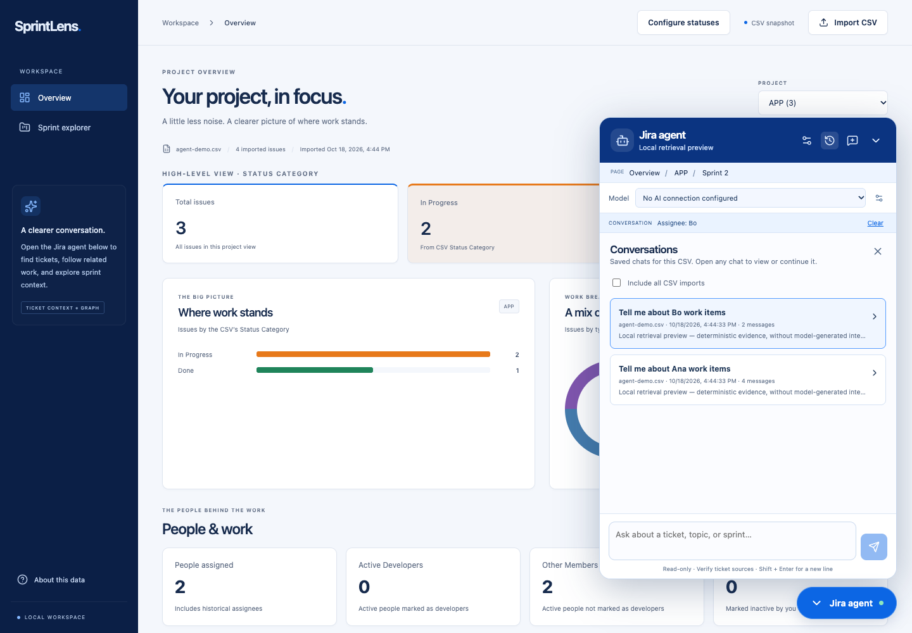

# Conversation memory and model context

Discuss a developer's work, then ask `What are the high priority tickets?`. The agent carries forward that person's exact exported identity and combines it with the discovered priority value. Structured queries count the full matching set; semantic search filters eligible tickets before ranking. Page navigation is recorded separately and does not silently replace the conversation's scope.

Before retrieval, the selected model recreates a small working context from the latest question, prior active scope, and up to four recent message excerpts. It produces a short intent summary plus structured project/sprint/person/filter choices. The app validates names, sprint matches and filter values against the imported metadata; ambiguous identities require clarification. The summary contains scope and intent, not ticket facts or private reasoning. This adds one bounded model request per message, charged to the same investigation budget. Tiny windows or unavailable/invalid context updates use the validated scope resolver; quota exhaustion stops without automatic retry.

A standalone sprint report covers the whole sprint unless the user explicitly names or refers to a person. For example, after discussing a developer, “report sprint 42” replaces the employee scope; “his high-priority tickets” retains it. A correction such as “no, in general overall” clears the old person, narrow filters and ticket list while retaining the sprint/project under discussion. Model-generated subqueries cannot silently turn their filter into the next message’s scope after such a reset.

The **Remembering** summary beside the message box streams the newly resolved intent and scope before the answer arrives. It shows the current person, project, sprint and filters. Failed/cancelled requests restore the last saved display. Explicit names or a different sprint update it; requests such as `all projects`, `everyone` and `all priorities` widen the applicable scope. **Start fresh** ignores earlier context for the next message, with an Undo option. Ambiguous or unknown people require clarification rather than substituting a prior person or unrelated semantic results. Person identity still depends on exported names; the CSV cannot distinguish two people with the same name.

## Saved conversations

**New chat** starts with empty memory and retains older chats. **Conversation history** lists saved titles, timestamps and previews, with pagination. Resume a chat to restore its scope and messages, including after a server restart. **Load older messages** retrieves earlier pages; the entire stored conversation remains viewable, independently of the model's bounded prompt.

The history picker initially lists the current CSV. **Include all CSV imports** also shows older snapshots. Opening one restores its original dataset and conversation together, preserving isolation between imports. This is a local single-user workspace, not a user authorization system.

MongoDB stores structured memory separately in `agent_session_memory`. After model success, the server stores the user/assistant exchange and updated memory in MongoDB. Standalone MongoDB uses ordered writes rather than a cross-collection transaction. Failed or cancelled model turns do not replace the saved context. Existing chats without this state reconstruct a best-effort scope from their available recent user messages and saved page hints on their next turn.

## Model-aware prompt budgets

Memory is not just a longer transcript. Each request includes the resolved structured scope, current request, navigation hints and retrieved evidence. Recent dialogue is selected within the chosen model budget; complete old native tool rounds can be omitted without leaving orphaned tool results.

| Budget | Compact | Expanded |
| --- | ---: | ---: |
| Local model configuration | Qwen3 8B | Qwen3 14B |
| Declared local token window | 32,768 | 40,960 |
| Recent messages, maximum | 12 | 32 |
| Recent history token budget, approximate | 6,000 | 14,000 |
| Characters per historical message | 3,500 | 7,000 |
| Characters per prefetched ticket excerpt | 2,000 | 6,000 |
| Total prefetched evidence characters | 20,000 | 48,000 |
| Serialized native tool-result characters | 12,000 | 24,000 |

The history and excerpt limits are upper bounds. The assembled prompt reserves 4,096 output tokens and a 10% margin. Token sizing uses an approximate UTF-8 byte estimate, not the provider's tokenizer. Messages may be reduced further to fit; a prompt that still cannot fit returns an actionable error. Full-scope aggregate counts remain authoritative even when example lists or narrative excerpts are shortened. `context_usage` records the effective profile, declared window, selected history and estimated request size.

The local aliases configure the serving context through `config/ollama/*.Modelfile`. Per-model JSON maps in `.env` set `JIRA_AI_MODEL_CONTEXT_PROFILES` and `JIRA_AI_MODEL_CONTEXT_WINDOWS`; Compose passes them to the backend. Original Ollama model tags are unchanged.

Saved connections expose **Conversation context settings**: declare the actual supported window and choose **Auto**, **Compact** or **Expanded**. Auto uses Expanded at a declared window of at least 40,960 tokens, otherwise Compact; an explicit per-model profile can override the environment choice. Saved profiles default to 32,768 and do not inherit environment mappings. Configure the serving endpoint separately; this field does not increase its real capacity. Larger contexts use more memory or provider tokens and do not guarantee better reasoning. On the current 16 GB Mac, the expanded 14B model caused substantial swapping during live verification; 8B remains the default. The model streams its own synthesis after tool evidence. Slow or output-limited turns fail without substituting a prepared report; saved memory and the retry draft are retained. Switching models preserves durable scope while changing the available history and evidence budget.

No CSV project, sprint or person name is hardcoded in these instructions. Resolved names and fields come from the import and verified tool results, passed as untrusted runtime data. The UI streams observable retrieval and analysis activity; private model reasoning is neither exposed nor saved.

## Implementation and verification

- `backend/app/agent/scope_planner.py`: selected-model context recreation, bounded prompts and metadata validation.
- `backend/app/agent/conversation.py`: scope resolution, verified tool observations, contextual ticket reports and prompt augmentation.
- `backend/app/agent/context_budget.py`: dialogue selection, result excerpts and complete tool-round pruning.
- `backend/app/agent/routes.py`: memory transactions, paginated histories and per-import boundaries.
- `frontend/src/AgentHistory.tsx` and `AgentChat.tsx`: new/resume controls, older messages and visible scope.
- `backend/tests/test_conversations.py`: developer/priority follow-ups, scope overrides, ambiguity, comparisons, custom fields, restart persistence, histories longer than the model window and compact/expanded input differences.
- `frontend/tests/agent.spec.ts`: desktop/mobile history resume, reload, context clearing and original-snapshot restoration.

[Mobile conversation history](../resources/images/conversation_history_mobile.png)

Historical verification of the superseded fixed-report path, retained for provenance: [recorded evidence](verification/conversation_memory.json). In that older path, 8B completed model curation in 23.63 seconds. 14B retained the same 19-ticket scope at 40,960 tokens and finished through the labeled fallback in 90.65 seconds. Verified tables began streaming in under 0.05 seconds for both; the resumed conversation retained all six messages. The initial memory rollout passed 104 backend tests and 34 desktop/mobile browser tests; see chat_experience.md for the subsequent verification.

## Message context controls

The blue header keeps the agent/model identity and one **Configure** entry for model selection, connections, answer mode, indexing and advanced model settings. Page/model strips no longer occupy the transcript.

**Context**, beside **Send**, opens a panel with the full latest remembered scope, **Start fresh**, and controls for **Use conversation history** and **Use current page**. Both are enabled initially and the browser remembers the user's choices. Page hints include the ticket currently open in the right-side details drawer, as well as project/sprint/view. With **Use current page** enabled, “this/open/current ticket” selects that visible ticket; an explicit key or attachment takes precedence. The ticket is resolved against the current import and its details are retrieved from MongoDB before an answer. Changing/closing the drawer updates/removes this live hint; a ticket deliberately discussed can still remain in conversation memory. Disabling page context excludes the drawer hint from retrieval and model navigation. Page hints never restrict access to the rest of the imported snapshot. The backend records the observed page with an enabled flag for audit/history, while disabled hints are excluded from active retrieval and model navigation context.

Explicit wording takes priority, then resolved conversation memory, then enabled page hints. Topic retrieval checks matching page evidence and the full resolved scope; it deduplicates sources and can return work outside the visible page. User-specified and remembered filters remain exact constraints, and an empty result never silently discards them. “This sprint” continues the sprint already being discussed before consulting the page; without either, the agent asks which sprint.

**Start fresh** is a one-message action: it ignores earlier people, tickets and filters, and excludes old dialogue from the model prompt. It does not delete visible history. The successful message records a prompt boundary, so later follow-ups cannot reintroduce pre-reset dialogue. **Undo** cancels the pending action. Turning off conversation history applies the same isolation to each message until re-enabled. Page hints remain a separate choice, and attached tickets are always explicit context.

## Clarify references and preserve the question

A visible answer's discussed ticket list is stored separately from the user's single-ticket focus. Search results and source drawers do not select a ticket. “Explain this ticket” after several tickets were discussed asks for a key/title or attachment and waits for a reply; a clear single-ticket focus or unique attachment proceeds without a redundant question. Candidate selection survives resume and can use a ticket title or an ordinal when the prior clarification visibly ordered its options.

The `clarify` planning route allows an AI-written question without a retrieval call. Unresolved references cannot trigger speculative ticket/semantic lookups. The agent still uses metadata discovery when a missing name can be resolved from the database. Clarification is an ordinary saved conversation turn; the model retrieves the selected ticket after the user answers.

Plural follow-ups retain both the discussed set and the task. After “who handles these tickets?”, “what about the other tickets mentioned above?” continues the ownership question. `ticket_ownership` fetches assignees/reporters for every referenced key in one MongoDB query, keeping reporters separate from owners and unassigned tickets explicit. Historical or typical responsibility cannot be inferred from current assignments alone.

Ownership answers for a referenced list must retrieve evidence for the full set and include every requested key. A partial draft gets one model revision rather than silently dropping tickets. These short list answers are held until coverage is checked, then delivered as text deltas; other answers keep their normal streaming behavior. No answer table or wording is generated by a fixed template.

Verification: 149 backend tests and 48 desktop/mobile browser checks passed. Added tests exercise clarification, selection/resume, complete four-ticket ownership answers, dropped partial drafts and both provider protocols (including Gemini). A [live local 8B check](verification/reference_clarification.json) used synthetic tickets and asked for clarification with zero retrieval calls. This smoke check does not establish general model accuracy.

Open-ticket context verification: 162 backend tests passed. The browser suite passed 53 of 54 checks initially; a reload check overlapped a frontend rebuild and passed when rerun. Both desktop/mobile drawer-context and window checks passed against the final build. Coverage includes drawer changes, page-context opt-out, explicit keys/attachments, stale hints, persisted follow-ups, and broader questions without forced ticket scope.

## Messages during a response

The composer stays editable while Sprint Agent responds. In **Configure → Messages during a response**, choose:

- **Queue** (default): new messages wait above the input and run in order after the current answer, using its saved conversation context. Remove a queued message before it starts.
- **Steer**: up to four follow-up messages can update the active response. At the next model-request or tool-action boundary, the server discards the unfinished answer, recreates context and investigates the ordered messages together. Later corrections supersede conflicting earlier requests. An in-flight provider request finishes first; it cannot be interrupted remotely.

The four-message steering limit covers the entire response, including restarts. A fifth submission shows **Please wait for responses** and retains the draft. A message arriving just after the response seals becomes a queued next turn. Steering shares the original investigation time, action and model-request budgets; it does not grant unlimited provider calls. The completed conversation saves every accepted user message and one final answer.

**Stop generating** pauses delivery. Stopped or failed requests remain in Pending messages for explicit resume or removal, and newly typed drafts remain intact. Pending messages live in the current browser session and are not saved until answered; reloading the page clears them. Starting a new chat clears pending messages.

Drafting is allowed before the index or model is ready. Sending instead opens an explanatory popup with a Configure shortcut; no chat request is sent. The API independently enforces index/model readiness.
