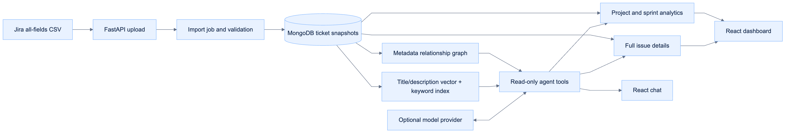

# Data foundation and delivery plan

See [Jira configuration research](jira_configuration_research.md) for the distinction between status categories, statuses, board columns, and other project customization.

The first release answers: how much work exists, where it stands now, and which issues belong to each sprint. Read-only agent assistance now builds on the same validated issue records and analytics service; see [Sprint Agent](jira_agent.md).

## What the supplied export contains

The inspected `jiratickets.csv` has **2,139 issues, 232 columns, six projects, eight issue types, and 12 statuses**. The largest project contains 2,047 issues; the other five projects contain 92 combined. Project selection is essential to avoid mixing boards and workflows.

| Field group | Available information | How this release uses it |
| --- | --- | --- |
| Identity | Issue key, ID, summary, project, type | Validate unique issues, select projects, find tickets |
| Workflow | Status, Status Category, resolution | Current status charts and completion metrics |
| Planning | Four repeated Sprint columns, priority, story point estimates | Sprint membership, priority/type charts, estimate coverage |
| People | Assignee, reporter, creator, QA owners | Assignee search and issue details |
| Relationships | Parent, parent key, linked issues | Resolve parent key/ID and Epic Link, purple parent badges, direct related-ticket navigation |
| Context | Description, acceptance criteria, comments, labels, attachments | Preserve every exported field and repeated occurrence |
| Dates | Created, Updated, Resolved, Status Category Changed | Show original values in issue details; do not infer missing events |
| Release | Fix versions, affects versions | Preserve as a foundation for later release summaries |

There are 171 issues with a second populated Sprint column, eight with a third, and one with a fourth. A dictionary reader that discards duplicate headers would lose this history. The importer reads by column position, unions sprint membership for analytics, and retains all original values for details.

## High-level categories, detailed statuses, and one setup

The high-level cards use the exact **Status Category** values supplied by the CSV, plus Total issues. For this export those are **Done: 1,749; In Progress: 103; To Do: 287**. No category names are hard-coded or inferred. Missing categories are displayed as Not provided instead of reconstructed from status names. The first dashboard view covers All projects; choosing a project scopes the cards and is remembered across refreshes.

Below that overview, detailed status cards use the distinct **Status** values. There are **no fixed destination buckets and no default status grouping**. Renaming or combining detailed statuses never changes the source category totals. Project and sprint views show category cards and detailed status cards; both can filter the sprint issue list independently. Selecting one clears the previous selection.

For the supplied export, the default cards are:

| Discovered status | Issues |
| --- | --- |
| Done | 1,715 |
| To Do | 280 |
| In Progress | 58 |
| Production | 32 |
| Dev Complete | 20 |
| Testing | 14 |
| Test Complete | 6 |
| Parking lot | 6 |
| Assessment In Progress | 3 |
| Approved | 2 |
| Week 9 | 2 |
| Change Request | 1 |

Both the twelve detailed status counts and the three high-level category counts sum separately to **2,139**. A selected project shows only its discovered statuses. A selected sprint keeps every status from that project visible, including zero-count cards.

After processing a new CSV, users see a single setup table: **Discovered status → Display as / combine into**. Each input initially contains the exact source status name. Users can keep it, type any stage name, or type the exact same name for several statuses to merge their counts. There are no predefined destination choices, additional category setup, or completion/testing roles.

For example, explicitly renaming Production and Done to Shipped produces one Shipped card whose count is their sum. Leaving the inputs unchanged keeps both cards. Names are case-sensitive; outer whitespace is trimmed. Custom names may have up to 120 characters; unusually long original status names can remain unchanged. Raw statuses differing only by case remain separate unless a user explicitly combines them.

The setup's project selector retains drafts when switching projects. Save validates all projects before one database transaction, so a bad assignment cannot partially save an import's setup. Users can also choose Use original statuses to save original names and open the dashboard. Pending setup resumes after a browser refresh. Configure statuses on the dashboard reuses the same table; there is no second configuration model.

A count preview shows the cards before saving. The database stores a versioned mapping from exact source status to user-entered label, a complete status order, and per-status hex card colors. Up/down controls and color pickers appear in the same import-time setup and later configuration. Renamed/combined cards follow the first member’s position and share one color. All-project cards with a shared display label use the first contributing project’s color and position; project views retain their own settings. Invalid orders or colors fail validation without overwriting saved settings. Card IDs derive from the full label, supporting spaces, punctuation, Unicode, arbitrary stage names, and more than thirty distinct statuses. Existing explicitly saved legacy stage labels are retained, while old fixed bucket roles are discarded. Imports with no saved mapping always use original names.

All counts are scoped to a selected project or all projects; sprint counts add a membership filter. In all-project views, identical display names aggregate across projects, with each project's mapping applied independently. Every issue contributes once. Clicking a sprint KPI clears previous ticket filters and shows exactly its counted issues; search/type/priority/raw status can then narrow the selection. Total restores all issues in that sprint. Stage totals always describe the entire scope, independent of search and pagination.

Source issue records, including raw Status and Status Category, are never rewritten. Story point totals and estimate coverage retain their previous definitions. Raw Jira dates remain text.

### Flexible optional columns and explicit interpretation

Issue key, Summary, Status, and Issue Type are the required roles. `columns.py` defines aliases, including Work item key, Title, Work Type, and Workflow status. Matching ignores case, whitespace, and underscores. Conflicting core aliases fail explicitly. Localized or unrelated names must still be renamed to a recognized alias; there is no arbitrary core-field mapping editor.

Any additional named column is accepted within the size limits. Raw values, empty occurrences, and duplicate headers are preserved. `csv_schema.json` is a reference for the original sample, not an allowlist. Import metadata records recognized roles and additional columns. The setup screen summarizes what was found before the same single status setup.

The field catalog profiles populated issue counts, distinct values, and repeated columns. The field explorer charts short fields with 1–50 distinct values and lets users filter exact values or blanks. Long text and high-cardinality fields remain in searchable details. Each issue counts once per distinct trimmed field value, so multi-valued fields can overlap. The exported-field explorer lives in Overview and describes the selected project across all sprints. Clicking a value opens Sprint explorer with All issues selected and an exact field filter; ticket filters narrow the list without changing chart totals.

Resolution is discovered separately and can filter tickets, including blank values. Story points and original/remaining/spent time are separate totals with separate coverage. Known numeric Jira time fields represent seconds and are displayed as hours. Unknown units are never converted. Zero is a supplied estimate; blank, nonfinite, negative, or conflicting recognized estimates are excluded from totals and flagged. Story point estimate and Story Points headers are both supported. Atlassian documents [numeric export units](https://support.atlassian.com/jira/kb/understand-how-the-original-estimate-field-value-is-calculated-when-viewing-the-data-export-in-jira-cloud/) and [the different story-point headers](https://support.atlassian.com/jira-software-cloud/docs/edit-the-story-point-estimate-of-an-issue-with-your-keyboard/).

### Hierarchy and type presentation

Parent relationships use an explicit Parent key, otherwise Parent/Parent id, otherwise Epic Link. References resolve to full keys, unique exported Issue IDs, or ticket numbers within the source project. A bare number matching different tickets through ID and ticket-number lookup is ambiguous and is not guessed. A matching ticket need not have a particular type. Duplicate issue IDs do not establish a parent. Missing external parents stay labeled unavailable in the export. Cyclic parent edges are excluded from navigation with warnings, while raw values remain intact.

Ticket titles replace resolvable keys/numbers in the issue list’s parent hint, related-work navigation, exported relationship fields, and field charts. Explicit key references can be discovered in any column; bare numbers are interpreted only in recognized relationship/identity headers, never in points, time, dates, or other numeric fields. Repeated relationship columns remain independent. Original source values are available via Show original CSV values, with reference keys also available as tooltips.

A ticket with direct exported children receives a purple parent badge and row accent; type badges are independent. Bug/Defect uses coral, Epic purple, Story teal, Task/Sub-task blue, and other discovered types get deterministic colors. The drawer opens direct parents and children across the entire snapshot, even if they are in other sprints or projects. A ticket may be both child and parent. Parent/children filters consequently overlap for intermediate hierarchy nodes. An empty Epic is not flagged as a parent merely because of its type.

Counts are direct children across the full export, not filtered descendants. Issue totals and estimate sums continue counting each exported issue once, including both parent and child records. There is no inferred rollup or deduplication of parent and child effort. The supplied snapshot has 76 parents with direct children and 1,018 issues with parent references.

On startup, older normalized summaries are enriched from their stored raw fields, including relationships, resolutions, and estimates. Existing source values, status mappings, and dataset IDs are retained; re-uploading is unnecessary.

## People and work areas

The People & work section in Overview counts distinct nonblank Assignee names, explicitly marked developers (the Active Developers card), other active people (Other Members, immediately to its right), and Inactive Members. Other Members includes active assignees without a developer flag, including unlabeled people. Active Developers plus Other Members plus Inactive Members equals People assigned. In all-project views, a person active in any selected project counts as active once; developer classification considers active project profiles only. Manage people shows the project-level ticket-type distribution for each person. Overview also shows a horizontal people-by-role chart; a bar opens the editor filtered to that role. Sprint explorer shows the same chart using only people assigned tickets in the selected sprint, with role-coverage counts. A person counts once per role regardless of ticket count. Multi-role totals overlap, and inactive people remain represented in historical sprint charts. A successful save closes the editor and refreshes data in place; failed writes retain the editor and drafts. A failed post-save refresh is reported separately from a failed write. Users may enter up to eight arbitrary work-area labels (80 characters each), separated by commas, and independently mark a developer flag. Suggested areas are Data, AI, DevOps, Backend, Frontend, and Lead; these are suggestions, not an exclusive taxonomy or inferred roles.

Membership is explicitly active or inactive per project, editable and filterable in Manage people. Existing profiles default to active; role edits from older clients preserve a saved inactive flag. Inactivity is never inferred from old tickets or sprint absence. Inactive people retain their work areas, developer flag, source tickets, type mix, and historical sprint counts, and may be reactivated. Work-area counts include all members. Profiles persist by dataset, project and exact assignee name. Saves validate every person before one transaction. People can have several work areas, so area counts overlap. The all-project count deduplicates exact names; identical display names belonging to different humans cannot be distinguished from this CSV alone. These are current assignments, not employment headcount, capacity, workload effort, or past contributions. Missing Assignee data yields zero observed people and an explanatory message.

CSV separator, required-header, duplicate-key, quoting, row-width and encoding errors produce actionable import messages. No partial issue rows are saved after validation failure. Import notes are available before status setup, including unmatched relationships and invalid estimates. Failed uploads can be corrected and retried while earlier successful datasets remain available.

## Workspace navigation

Overview and Sprint explorer render separate right-hand views. Overview contains project-wide category/status metrics, type charts, People & work, and exported-field analysis. Sprint explorer contains the sprint selector, category/status filter cards, estimates, a Charts & team section with status-category, role, priority and issue-type charts, and ticket list/details. Overview category/status cards open matching tickets in Sprint explorer with All issues selected. Sprint people cards show distinct nonblank assignee names, distinct reporter names, and their union. They recalculate for the selected project and sprint, including All issues and Unscheduled, independently of ticket search, filters, and pagination. A person in both roles counts once in People involved; the CSV records roles at export time rather than historical participation. There is no Issue directory navigation item. Both views share the project selector and top status-configuration button. URL fragments retain the selected view on refresh and support browser back/forward; sprint/filter state is retained while switching views in the session. Overview’s people and field analysis always use the whole project, independent of the last selected sprint.

## What a CSV cannot establish

- **Active sprint:** only names are present, without sprint IDs, dates, or active/closed flags. Natural name ordering suggests a default; users can mark a sprint active in this browser. That marker is a user choice, never an inferred Jira fact. Multiple board names can make name ordering particularly unreliable.
- **Historical sprint delivery:** an issue's status is its status at export time, not necessarily its status when a past sprint ended.
- **Moved to production over time:** current Production status does not prove a deployment date or identify every issue ever deployed. Completed issues may previously have been in production.
- **Burndown, velocity, carryover, cycle time:** reliable versions need sprint metadata, committed scope, and issue transition history. Created/Updated alone cannot reconstruct those events.
- **Time-based metrics:** raw Jira dates have no reliable timezone metadata here. This release preserves them as text and does not invent timezone conversions or date-based charts.
- **Attachment contents:** the export contains attachment references, not the attachment files. They remain text; the application does not retrieve external content.

## Architecture and boundaries

[Editable diagram source](diagrams/data_architecture.mmd)
CSV is the import format. MongoDB stores validated ticket snapshots, metadata and application state. SQLite is used only for the rebuildable vector/keyword/graph index. `make start` launches both the app and MongoDB with files under `resources/`. Uploads create separate snapshots with immutable source issue records rather than merging unknown export histories. Both normalized issue summaries and full exported field values are stored. The original CSV bytes are not retained by the server. A SHA-256 fingerprint identifies the input.

`backend/app/importer.py` owns decoding, repeated fields, validation, and normalization. `columns.py` defines aliases and numeric units; `fields.py` profiles optional fields; `hierarchy.py` resolves direct relationships. `workflow.py` owns discovered statuses, free-text stage validation, and the shared classifier. `analytics.py` owns metric definitions. `store.py` owns persistence. `main.py` exposes job status, projects, analytics, paginated issue queries, and detail endpoints. React consumes those endpoints and does not recompute business metrics.

Imports run in a background task on a **single API process**. The job and completed snapshots survive restarts; unfinished jobs are marked failed on startup and can be re-uploaded. This is suitable for a local first version. Multiple API workers or reliable distributed jobs would require a separate worker queue and ownership/locking of jobs.

## Continuous improvement sequence

1. **Delivered: general analytics and configurable workflows.** Upload, explicit processing state, project overview, charts, sprint selection, user-marked active sprint, issue filters/pagination, complete issue drawer, persistence, error recovery, dynamic status cards, import-time setup, typed display names, flexible extra fields, estimate units, resolution filters, type colors, and parent/child navigation.
2. **Richer data.** Introduce Jira API synchronization and sprint metadata, retain snapshots with clear source timestamps, and add history-backed metrics only when the underlying events exist.
3. **Delivered: read-only AI assistant foundation.** The agent has bounded tools for finding issues, reading details, traversing relationships, and retrieving deterministic analytics. Project status answers cite issue keys and snapshot timestamps. Triage and backlog suggestions remain proposals. Descriptions/comments are untrusted content, not agent instructions.
4. **Release notes.** Use explicit fix-version/release scope, cite included issues, and let users review generated drafts. Do not equate Done with shipped.
5. **Planning and retrospectives.** Add team capacity, active sprint dates, historical scope/status events, and explicit planning rules before suggesting commitments or diagnosing delivery patterns.
6. **Optional Jira writes.** Introduce authentication, project permissions, action previews, user approval, and audit logs before creating or editing Jira issues. Nothing in the first release writes to Jira.

The next useful product decisions are whether users need to carry saved display names into new exports, whether they need to compare exports, and whether the next data source should be uploaded snapshots or the Jira API.

## Implemented read-only agent

The first agent phase now includes floating chat, optional import-time or later indexing, hybrid vector/keyword retrieval, explicit relationship GraphRAG, ticket attachments, exact project/sprint aggregate tools, and configurable model adapters. See [Sprint Agent](jira_agent.md) and [retrieval/workflow contract](retrieval.md) for the current behavior; roadmap items concerning future live integrations remain proposals.
