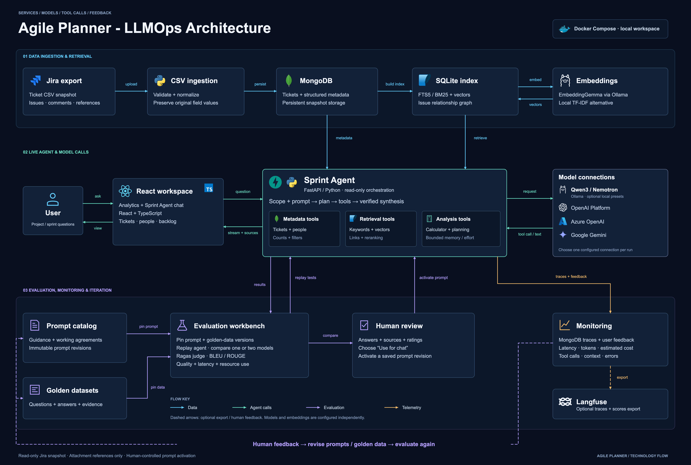

# Agile Planner - LLMOps Architecture



[High-resolution PNG, 6000 × 4040](../../resources/images/agileplanner_llmops_architecture.png) · [Scalable SVG](../../resources/images/agileplanner_llmops_architecture.svg) · [Editable draw.io](agileplanner_llmops_architecture.drawio)

This second diagram combines the supplied references' service-box architecture and LLMOps feedback loop. It retains the project's actual stack: Jira CSV ingestion, Python/FastAPI, React/TypeScript, MongoDB, SQLite, configurable model/embedding connections, evaluation and observability. Icon assets are embedded in the SVG and draw.io file; neither export needs an external image server.

The connections show these distinct flows:

- **Blue:** export ingestion, persistence, indexing and evidence delivery.
- **Green:** user questions, streamed answers and model request/response traffic.
- **Purple:** pinned evaluation assets, replayed tests, result comparison, human prompt activation and feedback-driven revisions.
- **Amber:** local monitoring records and optional Langfuse export.

Model families and provider connections describe supported configuration, not a claim that every endpoint is currently connected. Qwen3 and Nemotron are local presets served through Ollama. EmbeddingGemma is a documented embedding configuration; local TF-IDF is a separate lexical alternative, not an automatic recovery from a failed embedding service. Ragas uses a configured judge. Langfuse export is optional. The default Docker Compose runtime starts the application and MongoDB; model services are configured separately.

Content was checked against `frontend/package.json`, `backend/requirements.txt`, `backend/requirements-evaluation.txt`, `compose.yaml`, [model configuration](../../config/ollama/README.md), [retrieval](../retrieval.md), [LLMOps](../llmops.md), [evaluation](../evaluation.md), and [observability](../observability.md). Private runtime settings and ticket content are not included.

To edit individual objects, open the draw.io file in diagrams.net. To regenerate the exported files from their code source:

```sh
python3 docs/diagrams/build_llmops_architecture.py
node docs/diagrams/render_llmops_architecture.mjs
```

Rendering needs the frontend's installed Playwright package and Chromium. It checks text bounds, icon presence and image decoding before saving the PNG. [Technology icon sources](../../resources/images/icons/sources.md) are recorded alongside the local assets. Regeneration overwrites these named exports; save separately edited draw.io copies before rebuilding.
