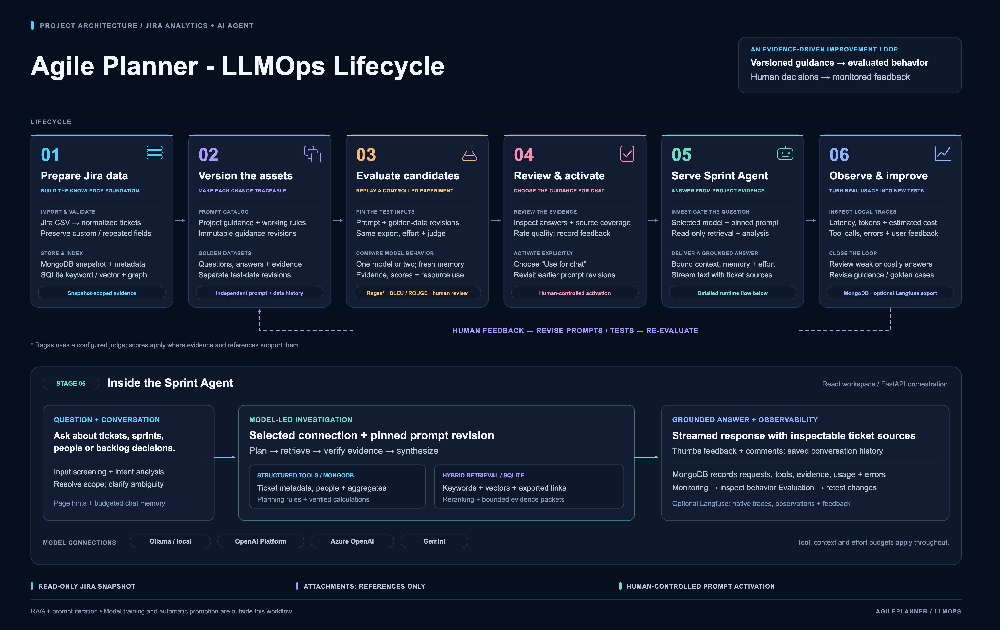

# AgilePlanner LLMOps lifecycle



[PNG, 5200 × 3280](../../resources/images/agileplanner_llmops_lifecycle.png) · [Scalable SVG](../../resources/images/agileplanner_llmops_lifecycle.svg) · [Editable draw.io](agileplanner_llmops_lifecycle.drawio)

Open the `.drawio` file in diagrams.net to edit individual shapes, text and connectors. The SVG and PNG use the same layout and wording. These exports represent the repository's implemented workflow; they do not report a live evaluation result or a production deployment.

The six stages connect Jira CSV ingestion and persistent retrieval to versioned project guidance, versioned golden datasets, controlled model evaluation, human prompt activation, read-only agent serving, monitoring and iterative improvement. The expanded runtime separates MongoDB metadata tools from SQLite hybrid retrieval and shows model connections, grounded answers and trace storage. Ragas judging and Langfuse export are configuration-dependent.

The content was checked against [LLMOps](../llmops.md), [retrieval](../retrieval.md), [evaluation](../evaluation.md), [monitoring](../observability.md), and the prompt-version, evaluation-job, input-screening and telemetry modules. The supplied reference image informed the lifecycle concept; no private Jira content or reference-image artwork is copied into these assets.

Regenerate the native files, then render and check text bounds using Python 3, Node.js, the frontend's Playwright package and an installed Chromium browser:

```sh
python3 docs/diagrams/build_llmops_lifecycle.py
node docs/diagrams/render_llmops_lifecycle.mjs
```

The builder overwrites these named exports. Editing the draw.io file does not update the Python source; preserve a separately edited version before regenerating.
