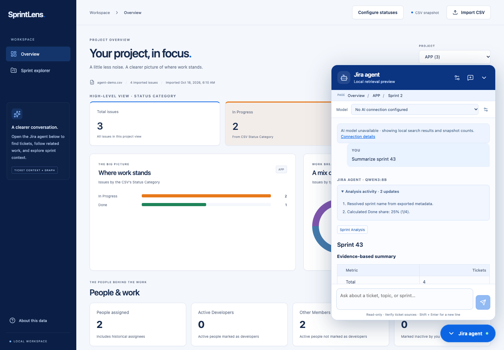

# Sprint Agent

The bottom-right **Sprint Agent** opens a read-only conversation within the current CSV; the selected project is a navigation hint. Sprint explorer also passes the selected sprint and the browser's user-marked active sprint. Open a ticket and click **Ask Sprint Agent** to attach it. Up to eight tickets can be attached to one question. Retrieved ticket keys and source cards open the existing issue details drawer.

## Test it locally

Upload a CSV and prepare its index during setup or from chat Configure. Analytics remains available without an AI connection; chat requires a connected tool-capable model. Open **Configure**, select or add the model, then ask a question. Missing/building/failed indexes show explanatory states and retry actions.

The model first interprets substantive questions through `plan_investigation`, chooses metadata/semantic/hybrid retrieval, calls tools as needed and streams its own answer. Project overview and other report requests follow that same loop. There are no prebuilt tables, fixed findings or automatic retrieval-answer fallbacks. Tools produce structured evidence; the model writes the response. See [the project-management role, owner context and capacity assumptions](agile_agent.md).

The explicit `mode=retrieval` API is a developer diagnostic, not a chat answer-mode option or automatic fallback.

## Switch models and add GPT connections

The **Model** selector under **Configure** in the blue chat header switches the model for the next question without rebuilding the ticket index. A fresh checkout starts without downloaded chat weights or personal connections. Start Ollama and use **Download Qwen 8B** in **Model connections** for the suggested first setup, or **Download Nemotron 8B** for that alternative. The app downloads through the local Ollama service, shows progress, supports cancellation/retry and creates a 32K connection automatically. Closing Configure leaves downloads running; completed connections are rediscovered when you return. Model files are reused across workspaces by Ollama; their connections and chat data belong to each workspace. You can add Qwen3 14B or other models manually. The application does not claim one model is universally best; both support reasoning and tool use. A message records the model that actually answered, so switching does not relabel older replies. The selected connection is remembered in browser storage. One conversation can continue across models, including its saved scope and a model-budgeted selection of recent history. Open **Conversation context settings** when saving a connection to declare its supported token window and choose an automatic, compact or expanded profile. Match this window to the actual serving configuration; selecting a larger number does not increase provider capacity.

Open **Configure** in the blue chat header. Choose the active model there, or select **Add model connection**:

- **OpenAI Platform / project API key:** enter a connection name, model ID and API key. Project ID and organization ID are optional request headers for the account's API project; they identify your API Platform project. Create the key inside that same project; requests are attributed to it through the key and optional `OpenAI-Project` header. The form links to the Platform API keys page and usage dashboard. Actual usage/cost remains in OpenAI’s dashboard; this app does not fetch billing with your chat key.
- **Azure OpenAI:** enter the HTTPS resource endpoint, your deployment name and API key. The server uses Azure's `/openai/v1/responses` endpoint. The API's model field contains the deployment name; an API-version field is not needed for this v1 route.
- **Google Gemini / AI Studio:** use the free-tier setup below.
- **Local / OpenAI-compatible:** enter the reachable `/v1` base URL and model name, with an optional API key. This can add other installed Ollama models without changing environment variables.

Save, then select **Test selected connection**. The test sends a small arithmetic/tool-calling request without Jira records. It can take a few minutes to load a local model; hosted tests may incur provider charges. Authentication, unsupported model/settings and network failures are shown without exposing credentials. Each saved profile currently selects one model/deployment; add more profiles for additional GPT models or projects. Profiles can be edited or removed. An empty API key during editing retains the existing key, except when changing its provider or endpoint, which requires re-entry.

API keys are write-only fields. They are encrypted with Fernet in MongoDB, using a generated `resources/app/.agent-secret-key` with mode 0600. The server returns only `has_key`, never the key or ciphertext. The encryption key and database must both be retained to restore connections; protect the data volume as a credential store. This remains a single-user local workspace: connections are shared within that workspace, not separate authenticated users. Hosted chat sends the selected conversation history and retrieved Jira context to that provider; local model selection keeps those requests on the local server.

Qwen3's named thinking settings on Ollama enable its boolean thinking mode; they do not provide distinct low/medium/high levels. The optional **Thinking setting** field supports other providers' model-specific levels too. Unsupported settings should be changed to **Model default**. Reasoning content stays internal; the UI displays streamed answers and observable tool/calculation activity.

This follows [Qwen3's function-calling guidance](https://github.com/QwenLM/Qwen3/blob/main/docs/source/framework/function_call.md), [Ollama's OpenAI compatibility](https://docs.ollama.com/api/openai-compatibility), [OpenAI project headers](https://developers.openai.com/api/reference/overview), and [Azure endpoint/deployment conventions](https://learn.microsoft.com/en-us/azure/foundry-classic/openai/how-to/switching-endpoints?view=foundry-classic).

## Gemini free-tier setup

Open **Configure → Set up Gemini free-tier option**. The template pre-fills `gemini-3.5-flash-lite` and uses the fixed Google Developer API endpoint, `https://generativelanguage.googleapis.com/v1beta/openai`. Create a key in [Google AI Studio](https://aistudio.google.com/api-keys), select a free-tier project, enter the key in the app, save and test. No Google key is bundled with the app, and no Gemini key was present in this workspace during implementation; live Google connectivity remains unverified until a key is entered. The Ollama 8B/14B connections remain usable immediately.

As checked on October 17, 2026, Google lists this stable model with free-tier input/output and function calling. [Current pricing](https://ai.google.dev/gemini-api/docs/pricing) and [model capabilities](https://ai.google.dev/gemini-api/docs/models/gemini-3.5-flash-lite) are authoritative. Model names remain editable for future changes. The app cannot determine billing tier from an API key; a paid Google project can incur charges even for a model with a free-tier offering. Use a free-tier project for this setup.

Google’s free-tier terms allow submitted content to be used to improve products. The connection form displays that policy and links to pricing/data terms before saving. Sending Jira context is an explicit chat action; the connection test sends no Jira records. For work that needs to stay local, select either Ollama model.

The Gemini adapter uses Google’s [OpenAI-compatible Chat Completions interface](https://ai.google.dev/gemini-api/docs/openai), with server-side bearer authentication and the same read-only Jira tools. It retains opaque tool-call/message thought signatures between tool rounds without displaying or storing them as answer text. Free-tier web grounding is not enabled. Project and organization headers apply only to OpenAI Platform; Google’s API key determines its Google project.

Google [rate limits](https://ai.google.dev/gemini-api/docs/rate-limits) vary by project and model, so the UI links to AI Studio rather than claiming a fixed free request allowance. HTTP 429 shows a quota/rate-limit message, retains the draft, and makes no automatic retry or fallback to another provider. Users can wait or explicitly choose a local model. Tests cover these paths with mocked Google responses, including encrypted/redacted keys and thought-signature replay.

## Connect a model through environment variables

Copy `.env.example` to `.env` and set the provider/model. Credentials stay on the server and are excluded from Docker build context. Never place them in a Vite variable or browser storage. Environment configuration supplies default model choices; saved UI profiles can supplement them.

For OpenAI:

```dotenv
JIRA_AI_PROVIDER=openai
JIRA_AI_MODEL=YOUR_TOOL_CAPABLE_MODEL
OPENAI_API_KEY=YOUR_API_KEY
JIRA_EMBEDDING_PROVIDER=openai
JIRA_EMBEDDING_MODEL=text-embedding-3-small
```

Then run `make start` to build/start, or `make restart` to apply connection settings to the already-built image without a rebuild. Rebuild the ticket index from **Configure** after changing embedding settings. AI chat becomes available as soon as the model configuration is present; connection/authentication/model errors appear when sending a question. Local retrieval preview remains selectable. A configured connection is not a live connectivity check.

To keep indexing local while using a hosted LLM, leave `JIRA_EMBEDDING_PROVIDER=local`. Only retrieved context and recent conversation messages go to the model when you send an AI question. Choosing remote embeddings sends all indexed ticket chunks to that provider during indexing, and search text during retrieval. Choose a provider appropriate for the export's contents.

For an OpenAI-compatible server with tool-calling Chat Completions and embeddings endpoints:

```dotenv
JIRA_AI_PROVIDER=compatible
JIRA_AI_BASE_URL=http://host.docker.internal:11434/v1
JIRA_AI_MODEL=YOUR_TOOL_CAPABLE_MODEL
JIRA_EMBEDDING_PROVIDER=compatible
JIRA_EMBEDDING_BASE_URL=http://host.docker.internal:11434/v1
JIRA_EMBEDDING_MODEL=YOUR_EMBEDDING_MODEL
```

`host.docker.internal` reaches a host service from Docker Desktop; use `127.0.0.1` for a Python development server running directly on the host. The endpoint must be reachable from the API process. Linux Docker may need a host-gateway mapping. Optional `JIRA_AI_API_KEY` and `JIRA_EMBEDDING_API_KEY` override `OPENAI_API_KEY`. Local embeddings can be used independently of either LLM adapter.

For development, export these variables before `make backend`, or load `.env` in your shell. Compose reads `.env`; Python does not automatically load it.

Public web search is optional: set `JIRA_AI_WEB_ENABLED=true` for the OpenAI adapter and enable **Allow public web search** in chat settings. The default is off. It is intended for public documentation. The agent is instructed not to search private Jira material on the web. Public URLs appear as clickable citations. The compatible adapter exposes local tools only. Calculator arithmetic is available in both adapters without an external service.

## Retrieval and vector storage

Read the [retrieval contract, ranking pipeline, performance boundaries and four analytical skills](retrieval.md) for the implementation details.

The vector and FTS indexes contain **ticket titles, descriptions, acceptance criteria, comments and attachment references**. All remaining columns stay in normalized MongoDB documents and original exported field arrays as queryable metadata. Ticket keys/project IDs are join/filter metadata, never injected into embeddings. Narrative search finds work by meaning; structured queries handle people, status, sprint, priorities, dates, estimates and custom fields. `get_ticket` fetches details/metadata by key.

Choose **Smaller / local EmbeddingGemma** (1,000-character maximum, 200-character overlap) or **Larger / local Qwen3 Embedding 4B** (3,000-character maximum, 500-character overlap) during import or under Configure. Both run privately in Ollama without API fees; the choice is saved per import. Install the selected model with `ollama pull embeddinggemma` or `ollama pull qwen3-embedding:4b`. See the [private setup](../README.md#private-local-ai-setup). A no-embedding configuration still supports explicitly labeled lexical TF-IDF/FTS search. Dense vectors use exact cosine ranking plus BM25 reciprocal rank fusion and issue-level deduplication; parsed vectors are cached by index build. No approximate-nearest-neighbor service is required for this local snapshot. Index version 6 requires rebuilding older indexes for the new chunk policies and repeated field labels. Source fingerprints, provider/model signatures and build timestamps invalidate stale indexes.

The graph remains separate: it represents validated parent/child, exported issue links and shared labels/components/versions. Those metadata values are not part of the vector content. Topic traversal requires meaningful seed evidence; no person match never becomes an unrelated graph result. Explicit project filters apply when requested, while all-export queries can cross the current page.

The original fields, analytics, saved roles and status configuration survive reindexing. Index replacement is atomic, failed indexing leaves analytics available, and interrupted indexing is retryable. MongoDB application records live under `resources/mongodb/`; the retrieval-only SQLite index lives in `resources/app/retrieval.sqlite3`. One server process coordinates local background builds.

## Agent execution

`provider.py` uses bounded multi-step tool loops for OpenAI/Azure Responses and compatible/Gemini Chat Completions. Nontrivial data questions initially expose the intent-planning tool; the next model request exposes the investigation tools. Required tool choice is used until evidence is available. Planning alone is not factual grounding. Attached tickets and exact-reference follow-ups may reuse explicit prefetched evidence. Clarifications and greetings still use the model.

All answer text comes from the model. Structured metadata, search, graph, aggregate, capacity and calculator tools supply facts. Owner project briefs supply goals and working assumptions separately from CSV evidence. Normal responses do not auto-render aggregate tables, charts or selected findings. Explicit visual requests may enable up to two charts from verified data. Tool actions and grouped usage stream while the model works; hidden reasoning is neither shown nor stored as answer text.

At most twenty native tool calls run within a 24-round loop. Local compatible connections have a 420-second loop deadline and 180 seconds per request; hosted connections have a 180-second loop deadline and 60 seconds per request. Each request allows 4,096 output tokens, including provider reasoning tokens where applicable. Context budgets remain model-aware. One retry is allowed for a skipped tool stage; valid tool calls reset that stage's miss count. A retry failure, timeout or incomplete response surfaces an error without substituting a report or saving an invented answer.

Conversation memory is resolved before model orchestration. Optional page hints are separate from conversation scope; the model can search the full export while exact user filters remain in force. Start fresh records a prompt boundary without deleting visible history. See [conversation controls](conversations.md#message-context-controls).

Saved credentials are encrypted locally. Hosted connections receive the selected prompt context. The application stays read-only and bound to a single local workspace; it does not modify Jira.

## Snapshot limits

Sprint summaries describe current exported statuses and membership. A ticket can be in several exported sprints, and each is counted once in the selected sprint. Distinct reporters are counted from nonblank reporter values, not combined with assignees. The browser's active marker is a user choice, not Jira sprint metadata. Without a changelog or live integration, the agent cannot establish who worked when, committed scope, velocity, burndown, status transitions, actual releases or historical delivery. Model instructions and tool responses state these limits.

This remains a local single-user application without authentication. Conversation IDs identify local histories; they are not a multi-user authorization system. No Jira write actions are implemented.



[Mobile analytical preview](../resources/images/agent_analysis_mobile.png) · [Model and GPT connection settings](../resources/images/model_settings_desktop.png) · [Gemini setup](../resources/images/gemini_setup_desktop.png)

### Environment model selector

```dotenv
JIRA_AI_PROVIDER=compatible
JIRA_AI_BASE_URL=http://host.docker.internal:11434/v1
JIRA_AI_MODEL=qwen3:8b
JIRA_AI_MODELS=qwen3:8b,qwen3:14b
JIRA_AI_REASONING_EFFORT=medium
```

Both models must be installed in Ollama. For reliable tool context, create app-specific 32K (8B) and 40K (14B) context variants from the repository root (the original tags remain unchanged):

```sh
ollama create sprintlens-qwen3:8b -f config/ollama/qwen3-8b.Modelfile
ollama create sprintlens-qwen3:14b -f config/ollama/qwen3-14b.Modelfile
ollama pull embeddinggemma
```

Add these settings to `.env`:

```dotenv
JIRA_AI_MODEL_ALIASES={"qwen3:8b":"sprintlens-qwen3:8b","qwen3:14b":"sprintlens-qwen3:14b"}
JIRA_AI_MODEL_CONTEXT_PROFILES={"qwen3:8b":"compact","qwen3:14b":"expanded"}
JIRA_AI_MODEL_CONTEXT_WINDOWS={"qwen3:8b":32768,"qwen3:14b":40960}
JIRA_EMBEDDING_PROVIDER=compatible
JIRA_EMBEDDING_BASE_URL=http://host.docker.internal:11434/v1
JIRA_EMBEDDING_MODEL=embeddinggemma
```

The UI keeps the familiar 8B/14B names; each answer records the actual provider model alias too. Aliases apply to environment choices; a separately saved local connection must use the desired installed tag. Larger contexts use more memory. These follow [Ollama's context-size configuration](https://docs.ollama.com/api/openai-compatibility). Run `make restart` after changing environment settings. Model switching and saved UI profile changes apply to new messages immediately. Profiles do not modify the embedding configuration or invalidate the index.

## HTTP endpoints

All are under `/api/datasets/{id}/agent`:

| Method | Path | Purpose |
| --- | --- | --- |
| GET | `/status` | Index progress/metadata and redacted provider availability |
| POST | `/index` | Reserve/build/rebuild the index in a background task |
| POST | `/chat` | Message, page/project/sprint hints, attachments, session_id, mode, connection_id, allow_web, optional skill, reset_context and stream flag; NDJSON when stream=true |
| GET | `/sessions?offset=0&limit=20` | Paginated conversation list for this CSV |
| GET | `/sessions/{session_id}?before_id=ID` | Restore a conversation and its saved scope; page older messages |

`GET /api/agent/conversations?offset=0&limit=20` lists chats across CSV imports, including original dataset ID and filename. Opening one restores that snapshot rather than mixing its memory with another export.

Workspace connection endpoints: `GET/POST /api/agent/connections`, `PUT/DELETE /api/agent/connections/{id}`, and `POST /api/agent/connections/{id}/test`. Connection requests are allowed from the local app; secrets are never included in GET responses. Chat requests accept a `connection_id` selected from the server's configured choices. Arbitrary unconfigured model IDs are rejected.

`POST /api/imports` accepts optional multipart `prepare_agent` (default true).

## Verification and sources

After building, check your existing export/index without printing ticket contents:

```sh
PYTHONPATH=backend .venv/bin/python scripts/verify_agent.py /path/to/export.csv --dataset DATASET_ID
```

This prepares a missing index, checks its fingerprint/counts, tests exact/numeric lookup, project scope, aggregate totals and persisted source evidence using Local retrieval preview. It creates a few diagnostic conversations; it does not change imported records or saved profiles.


Backend tests cover exact references and ambiguity, repeated source fields, vector/keyword ranking, graph paths/topics/explicit project filters, late/missing/stale/failed indexes, distinct sprint reporter counts, safe arithmetic, session separation, embedding validation, provider tool loops, reasoning-item continuity and connection failures. Model/embedding adapter tests use mocked HTTP responses. The current verification passed 116 backend tests and 40 desktop/mobile browser tests. The existing 2,139-ticket export produced 2,389 title/description-only chunks, 2,180 graph nodes and 2,645 edges; exact/numeric references, explicit project filters, aggregate totals and session persistence passed live checks in local retrieval mode. Qwen3 8B and 14B passed live local reasoning/tool-calling checks. In the running app, 8B answered a project aggregate question using `project_summary`, then 14B analyzed an attached ticket using `get_ticket` in the same conversation, preserving source scope and model provenance. GPT and Azure adapters use mocked tests until users supply their own credentials. Browser tests exercise real API/indexing at desktop and mobile sizes, including attachment → answer → source drawer navigation, persisted conversations, sprint summaries, no-data/late-index states and retryable errors.

Implementation follows [OpenAI function calling](https://developers.openai.com/api/docs/guides/function-calling), [embeddings](https://developers.openai.com/api/docs/guides/embeddings), [optional public web search](https://developers.openai.com/api/docs/guides/tools-web-search), and [SQLite FTS5](https://sqlite.org/fts5.html). Provider/model capabilities must support the selected endpoint and tools.

Live checks on October 18 verified metadata-based employee lookup, numbered sprint resolution from a different project page, and a semantic-only topic query retrieving the expected ticket without a keyword match. Project names, person names, ticket keys and sprint names are discovered from the imported data; none is a fixed application instruction. The running index uses 768-dimensional local EmbeddingGemma vectors. Stream timing depends on model loading/thinking; activity and verified charts appear before generated answer text. This is retrieval sanity validation, not a comprehensive relevance benchmark.

[Chat reading controls, concise responses and architecture boundaries](chat_experience.md) describe the current interaction contract.
