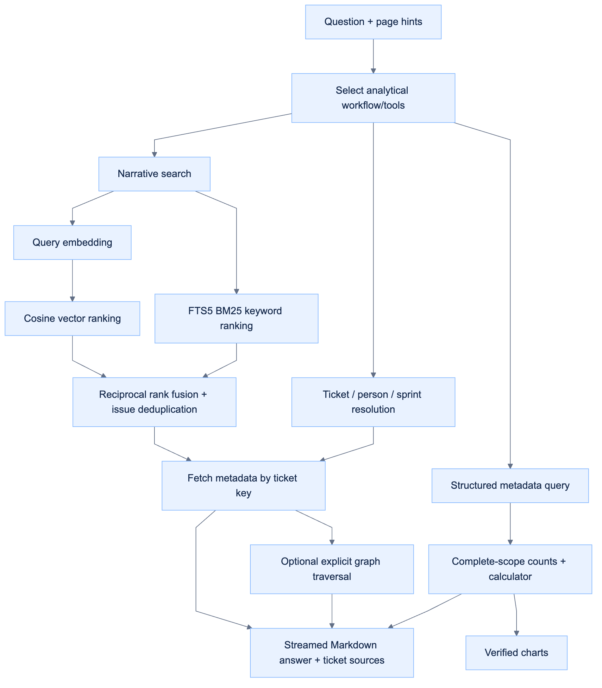

# Retrieval and analytical workflows

## Embedding setup and chunking

Both embedding models run locally with **no API key or per-token fees**. These are maximum **character counts, not token counts**. A smaller chunk can create more vectors, so smaller does not automatically mean faster indexing or better retrieval. Model quality and speed should be checked against your own ticket questions.

**For a new import:** choose **Embedding model & chunk size** on the upload screen. Leave **Prepare the Sprint Agent index after import** checked to build immediately. If you uncheck it, the choice is still saved; prepare the index later from Sprint Agent.

**For an existing import:** open **Sprint Agent → Configure**, choose the embedding profile, then click **Rebuild ticket index** or **Prepare agent index**. Selecting an option alone does not rebuild or replace the saved configuration. A model change requires rebuilding all vectors for that import; other imports keep their own choices. Search is ready when the index reports **Ticket context is ready**, with its model, ticket/chunk counts, character cap and overlap. The saved index is reused across conversations, refreshes and restarts.

**What gets embedded:** each ticket's summary, description, acceptance criteria, exported comments and attachment references. `Comment`, `Comments`, `Custom field (Comment)` and `Custom field (Comments)` are supported. Attachment contents are never downloaded or embedded. People, status, sprint, estimates and other metadata remain queryable in MongoDB; IDs and project keys join results back to their original tickets.

**How chunks work:** a ticket that fits stays in one chunk, even if undersized. Larger tickets split without combining content from different tickets or truncating the narrative before splitting. Every chunk repeats the title and the Description, Acceptance criteria, Comments and Attachment references headers. A field without an excerpt in that chunk is marked explicitly. Repeated titles and headers count toward the cap; the 200/500-character overlap preserves narrative text across field boundaries. Long summaries are retained in a separate full-summary field as well as the repeated short title.

**From export to answer:** import complete ticket fields and metadata into MongoDB, build the per-ticket chunks, embed them with local Ollama, then store vectors and the keyword index in SQLite. Questions use the same embedding model as that import's index. Hybrid retrieval combines vector similarity with keyword matches; relevant ticket details and comments are supplied to the selected chat model for its answer. The original CSV is not reopened for each question.

Older imports may show **Current server configuration**, which reflects the legacy `JIRA_EMBEDDING_*` environment settings and can include a hosted provider. Choose **Smaller** or **Larger** and rebuild to move that import to the explicit private Ollama setup. The private profiles use `JIRA_LOCAL_EMBEDDING_BASE_URL` and never inherit a hosted embedding API key or silently switch to cloud embeddings. If a model is missing, run the `ollama pull` command shown by the chooser, keep Ollama running, and retry. Analytics remains available while the index is missing, building or failed.

## Separate the three jobs

The vector index contains **Summary, Description, acceptance criteria, exported comments and attachment filenames/references**. Attachment bytes are not downloaded or indexed. Status, category, priority, assignee, reporter, sprint, dates, story points, labels, components, IDs and other custom fields stay in MongoDB as queryable metadata. CSV is read only at import; MongoDB is the runtime source of truth, including complete original field arrays. Repeated Jira headers remain multi-value lists.

Ticket key, project and chunk ID are stored beside vectors for joining/filtering, but are not embedded. A metadata value appearing naturally in a title/description remains part of that narrative; it is not injected from its column.

[Editable diagram source](diagrams/retrieval_workflow.mmd)
## Narrative search

1. Choose **Smaller / EmbeddingGemma** for a maximum of **1,000 characters** with **200-character narrative overlap**, or **Larger / Qwen3 Embedding 4B** for **3,000 characters** with **500-character narrative overlap**. These are character limits, not token counts. The repeated title counts toward the maximum; the title is capped at 160 characters. Prefer paragraph/sentence/word boundaries near the cap and preserve exact narrative overlap across field boundaries. Chunks never mix tickets, and each repeats the title and field labels. Long titles are retained in a full-summary section. Narrative fields are split across chunks without pre-chunk truncation; full originals also remain in details. The key stays outside embedded text. Keyword-only and legacy server configurations use the smaller chunk policy.
2. Persist normalized dense vectors when an embedding provider is configured, together with lexical TF-IDF vectors and an FTS5 index. The default no-provider mode is explicitly lexical; it is not called semantic search.
3. The two private semantic choices use local Ollama: **EmbeddingGemma** (768 dimensions) or **Qwen3 Embedding 4B** (2,560 dimensions). The choice is persisted per import and used for document and query vectors. Model-specific query prefixes follow the retrieval task format. Private choices reject remote endpoints, omit API credentials and use the native Ollama embedding endpoint with truncation disabled. Connection failures never cause a cloud fallback. A different chat model does not require re-embedding.
4. Resolve explicit project/sprint filters before ranking. Keyword results are restricted to allowed issue keys before limiting, so a selected sprint does not lose candidates to another sprint's top hits.
5. Rank eligible chunks by cosine similarity and separately by BM25, then fuse up to 200 candidates per ranking with `1/(60 + rank + 1)`. Return at most 12 distinct tickets with matching excerpts. Dense candidates must exceed the configured model policy: 0.25 for EmbeddingGemma, 0.45 for other providers in this initial version. Dense candidates also stay within 0.10 cosine of the best eligible semantic hit, so weak generic overlap cannot gain a second ranking vote. Keyword hits can qualify independently. These are conservative initial thresholds, not universal confidence probabilities; evaluate on your project vocabulary before changing them.
6. Fetch status/people/sprint/priority metadata after finding ticket keys. The model must use aggregate/query tools for totals, never the number of search hits.

The embedding model was checked with a password-recovery query against a related description and an unrelated database-deployment description; the related cosine score exceeded the unrelated score. This is a sanity check, not a comprehensive retrieval-quality benchmark. Real project checks should measure top-k recall on known questions, no-match behavior, employee identity resolution and graph provenance independently.

## Performance and boundaries

- SQLite FTS5 provides indexed lexical retrieval. Vector search is exact cosine ranking in Python, not an approximate nearest-neighbor service.
- Parsed chunk vectors are cached for the two most recently searched index builds, keyed by dataset/build timestamp. A rebuild clears that cache. Query embeddings still run per query; no stale cross-model query cache is used.
- Project/sprint filters reduce the candidate set. Ticket-level deduplication avoids spending the answer context on many chunks of one issue. Excerpts, graph hops, tool calls, rows and output tokens are bounded. A ticket read limits original field-value excerpts to 12,000 characters in total and reports truncation; complete originals remain in the drawer and structured field queries.
- MongoDB indexes metadata fields. SQLite indexes retrieval key/project/chunk joins. Source fingerprint, index version, embedding signature/dimensions and build timestamp invalidate stale indexes. Index version 6 adds per-import model choices, strict character/overlap policies, complete short-ticket packing and repeated field labels without narrative truncation; a rebuild is required. Metadata remains in MongoDB.
- Index replacement is atomic. Failed indexing does not alter imported records, saved profiles, statuses or analytics. Interrupted builds are explicitly retryable.
- This is optimized for a local snapshot workflow. Very large exports require measured memory/latency limits, an ANN vector store and a separate indexing worker. No sub-second or large-scale throughput guarantee is made.

## Structured metadata queries

`query_metadata` accepts a project/sprint selector, up to eight validated filters (`eq`, `contains`, `empty`, numeric `gt`/`lt`), an optional grouping field and pagination. Fields can be normalized columns or exact original CSV headers. It returns exact matching totals, bounded example rows and grouped counts from the full filtered result. Each issue is counted once per distinct multi-value field value; such groups may overlap. The tool never executes model-supplied SQL or code.

`find_people` searches Assignee/Reporter metadata, with exact matches preferred over partial matches. `employee_analysis` uses the resolved name's actual assignments/reporting. A missing name stops with a clarification; semantic similarity or graph neighbors cannot be substituted for ownership. Same-name people cannot be distinguished without identity fields.

`resolve_ticket` and `get_ticket` can access any ticket in the current dataset. Ambiguous numbers prefer a unique current-project match as a navigation hint; otherwise they return candidates. Explicit full keys can cross the current page's project. Unknown keys are never invented.

`discover_context` exposes actual project/sprint names. `sprint_summary` resolves `43`, `Sprint 43` and uniquely matching exported names such as `Example Sprint 43`; multiple matches require clarification. "This sprint" uses the recorded page/active marker. Explicit sprint requests are resolved across the export unless a project filter is supplied.

## Graph retrieval

Issue nodes retain titles; topic nodes represent explicit labels/components/fix versions. Edges retain validated parent relationships and original issue-link header names. Traversal is at most two hops, 400 candidate edges and 20 returned issues. Keyword graph starts require a matching topic, lexical evidence or a strong semantic seed (cosine ≥0.65); unrelated weak semantic matches do not justify a graph expansion. A shared topic is not proof of a dependency, ownership or legal workflow transition.

## Four analytical skills

Project, sprint, backlog and employee prompts under `backend/app/agent/skills/` guide evidence gathering and concise AI synthesis. A shared management prompt supplies Scrum/project-management behavior, planning and retrospective guidance, workflow variability and conditional capacity reasoning.

The model identifies intent, selects metadata, semantic or hybrid retrieval and orchestrates the relevant tools. Aggregate tools compute full-scope counts and calculator-backed shares but do not render answers. The model writes the final response after seeing results; no prebuilt readout or fixed findings catalog is injected. Charts are off by default in AI mode. [Management-agent design](agile_agent.md) covers the flow and owner-provided project context.

## Scope, memory, streaming and formatting

The page's project, sprint and view are recorded on each turn as **hints**, not access restrictions. They are passed to the model as untrusted runtime data, separately from the generic system instructions; exported project/person/sprint names are never application defaults or prompt constants. The model can query all projects/sprints/tickets inside the same imported dataset and must report its actual query scope. Dataset boundaries remain enforced. One persisted conversation follows navigation across project and overview/sprint pages; legacy project-scoped sessions can be restored. Switching pages does not relabel prior answer scope. [Persistent conversation memory](conversations.md) resolves follow-up people and metadata filters before retrieval; these constraints apply to structured queries and the eligible semantic candidate set. Explicit scope changes replace inherited values. Every model request receives the saved scope as untrusted runtime data, with model-aware history/evidence budgets.

The frontend requests a real NDJSON stream. Backend events include observable analysis activities, actual tool execution/results, calculator operations, charts, answer-text deltas, completion and retryable errors. Verified skill tables stream before the provider request; general-conversation provider SSE text is forwarded as it arrives, without waiting for the whole answer. OpenAI Responses, Ollama/compatible Chat Completions and Gemini-compatible streams have separate protocol handling. Opaque Gemini thought signatures are retained between tool rounds.

**Private reasoning tokens and hidden chain-of-thought are not displayed or stored as answers.** The visible activity log explains the method through tool names, scopes, calculations and outcomes. A timer and heartbeat show liveness while a local model loads/thinks; streaming does not eliminate model compute time. Stop generating aborts the client stream; cancellation prevents saving a fabricated completed answer, and an in-flight model request may finish until its next stream event/timeout.

Markdown headings, emphasis, lists, code and GFM tables render safely. Raw HTML and images are disabled; ticket buttons are created only for retrieved source keys, and external links accept HTTP(S). Verified charts are server-produced aggregate artifacts, never arbitrary executable model output. Broken/incomplete streams do not save an answer; the draft is retained for retry.

Official protocol references: [OpenAI streaming](https://developers.openai.com/api/docs/guides/streaming-responses), [Ollama embeddings](https://docs.ollama.com/capabilities/embeddings), [EmbeddingGemma](https://ollama.com/library/embeddinggemma), [react-markdown](https://github.com/remarkjs/react-markdown).

## Recovery when a model skips retrieval

The model receives one retry when it skips a required planning/evidence stage. Ungrounded text is withheld. Successful tools supply their results for the next model turn, and tool selection remains bounded by count/time/context limits. Planning alone does not count as data retrieval.

If the retry also skips evidence, the turn fails explicitly and retains the draft and previously saved memory. No deterministic report or related-ticket answer is substituted. Optional explicit retrieval diagnostics are separate from normal chat. A connection test still requires an actual model-issued function call.

## Ranking and cache update

The narrative cosine + BM25 reciprocal-rank fusion now feeds a lightweight relevance reranker (title coverage, narrative coverage, phrase match, cosine and fused rank), followed by a diversity penalty across selected titles. This is a transparent local reranker, not a cross-encoder model. Exact result and query-vector caches are bounded and expire after ten minutes. Conservative semantic hits reuse candidate IDs only; the new query is scored and reranked again, with fresh lexical candidates. Full details and isolation rules are in [Chat experience](chat_experience.md).

## Bounded selected-model investigation

Metadata comes first for identities and counts. Assignee/reporter comparisons ignore letter case, short exact-name filters resolve unique substring matches, and ambiguous names or sprint/project matches request clarification. A verified assignment query is supplied before people-work synthesis, so an empty model-created short-name query cannot erase real matches.

`investigate_tickets` augments a focused question with resolved conversation scope and recent dialogue, filters MongoDB ticket keys first, and combines scoped hybrid candidates with a recency fallback. It checks full index chunks in bounded packets using the **same selected chat model**. Verified quotes must be verbatim substrings of known chunks; fabricated IDs/quotes are discarded. Repeating the same query advances the cursor instead of rereading the same packet. Exact evidence cache keys include dataset, scope, connection/model and packet; model answers are not reused as facts.

Investigation effort is separate from native model thinking. Low allows 6 tool actions / 5 combined model requests / 1 evidence worker; standard 12 / 13 / 4; high 20 / 21 / 8. Worker requests count toward the combined limit and reserve final synthesis. Candidate pools cap at 36/96/200 chunks; packets shrink to the configured context window. Timeouts, provider errors and quotas do not trigger another provider or automatic quota retries. If workers fail, scoped raw excerpts are explicitly labelled for the main model to inspect. Coverage distinguishes model-reviewed chunks, supplied excerpts and unreviewed context. No absence claim is justified from incomplete coverage.
